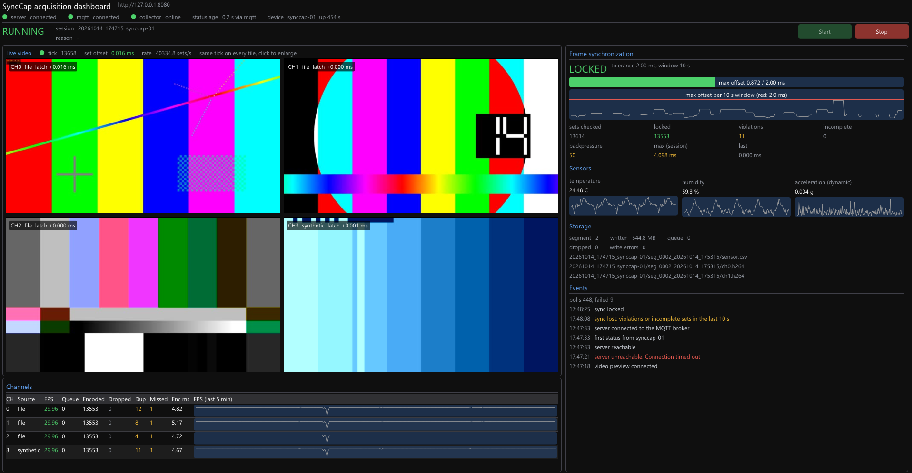

# SyncCap: 시뮬레이션 기반 다채널 비디오·센서 데이터 수집 시스템

GMSL 카메라 3~4채널(1920x1080)과 온·습도·가속도 센서를 하드웨어 없이 시뮬레이션해서 수집하는 시스템입니다. 상태를 모으고 제어를 중계하는 OpenAPI 서버를 함께 제공합니다.

- **synccap_collector**(수집 시스템, C++17): 채널별 비동기 캡처, 2 ms 이내 프레임 동기화와 검증, libx264 H.264 인코딩, 일정 간격(기본 3분) 분리 저장, 센서 수집, HTTP 상태 보고, MQTT 제어
- **synccap_server**(OpenAPI 서버, C++17): `POST /status`, `GET /status`, `POST /control` → MQTT, Swagger UI, Docker 이미지
- **synccap_dashboard**(모니터링 UI, Dear ImGui): 서버 REST로 채널·동기화·센서·저장 상태를 실시간 표시하고 Start/Stop 제어. 같은 화면에서 4채널 실시간 영상(같은 tick의 프레임)을 봄



설계 문서: [docs/DESIGN.md](docs/DESIGN.md)(아키텍처, 클래스·시퀀스 다이어그램, 시간 계약, 측정값, 원칙 예외)

---

## 1. 요구사항과 구현

요구사항 목록(R1~R11)은 [DESIGN 1.1](docs/DESIGN.md#11-목적)에 있습니다.

| 요구사항 | 구현 | 확인 방법 |
| --- | --- | --- |
| 입력 추상화 `IVideoSource` | `FileVideoSource`(MP4/AVI), `WebcamVideoSource`(OpenCV), `NetworkStreamVideoSource`(RTSP/HLS), `SyntheticVideoSource`(합성 패턴) | `config/*.json`의 `video.channels[].type` |
| 입력 추상화 `ISensorSource` | `CsvSensorSource`, `SimulatedSensorSource`(std::mt19937) | `sensor.type` |
| 20~30 fps 비동기 캡처, 3~4채널 | 채널마다 리더 스레드 + 캡처 스레드, 설정 검사(채널 3~4, fps 20~30) | 상태 JSON `channel_status[].fps` |
| Producer–Consumer, mutex/condition_variable, future/promise | 캡처 → 동기화 → 인코딩 → 저장 스레드, 상한 있는 `BlockingQueue`, 스레드마다 `std::promise` | [DESIGN 3.5](docs/DESIGN.md#35-스레드-모델) |
| 타임스탬프 동기화 ≤ 2 ms | 공통 tick(소프트웨어 FSYNC) + 절대 기한 래치 + 세트 검증. 위반 세트는 버리고 기록 | `sync_status`, `sync.csv`, `scripts/verify_sync.py` |
| 동기화 확인 API, 로그 | `VideoPipeline::get_sync_report()` / `isSynchronized()`, 위반 `WARN`, 10 s `STAT`, 세트별 `sync.csv` | 3장 |
| libx264 H.264(.h264) | libavcodec의 `libx264` 인코더(다른 인코더로 대체하지 않음), Annex-B | `ffprobe recordings/.../ch0.h264` |
| 타임스탬프 검증 후 인코딩 | 동기화기가 판정한 세트만 인코더 큐로 보냄 | `sync.csv`의 locked 수 = 채널별 픽처 수 |
| 일정 간격 분리 저장 | 영상·동기화 기록·센서 모두 같은 세그먼트 시계. 세그먼트 첫 프레임은 IDR이라 파일마다 단독 재생 가능 | `storage.segment_seconds` |
| `std::filesystem` | 세션·세그먼트 디렉터리 | `storage/SegmentedRecorder` |
| HTTP POST 상태 전송 20~30 s | `StatusReportComponent` + cpp-httplib, 타임아웃 5 s | 서버 `GET /status`의 `server_meta.received_http` |
| MQTT `video/status`, `video/control` | Paho MQTT C(비동기), 확인 응답 `video/control/ack`, 생존 `video/online`(LWT) | 5장 |
| OpenAPI 서버 + Swagger + Docker | `server/openapi.yaml`, `/docs`, `server/Dockerfile`, `docker-compose.yml` | 4장 |
| 유닛·통합 시험 | Catch2 109 case, 파이프라인 통합, 서버 API 통합, 미리보기 HTTP, 대시보드 모델·클라이언트, 종단 간 스크립트 | 6장 |
| (추가) 모니터링 UI | `synccap_dashboard`: Dear ImGui 1.92 + GLFW 3.4 + OpenGL 3 | 3.3장 |
| (추가) 4채널 영상 뷰어 | 수집 시스템 미리보기(`GET /preview`, 같은 tick의 JPEG 4장) + 대시보드 영상 영역 | 3.3장 |

---

## 2. 빌드

### Windows (Visual Studio 2022 이상, MSVC x64)

소스 형태의 서드파티(libuv 1.51, Paho MQTT C 1.3.16, GLFW 3.4, Dear ImGui 1.92.5, cpp-httplib, nlohmann/json, spdlog, Catch2, stb)는 `3rdparty/`에 버전을 고정해 두었습니다. FFmpeg 8.1 + libx264(GPL, shared) 바이너리는 저장소에 넣지 않습니다. 빌드 스크립트가 처음 실행될 때 `scripts/fetch_ffmpeg.ps1`로 고정 빌드를 받고 SHA-256을 검사합니다(따로 받으려면 `powershell -ExecutionPolicy Bypass -File scripts\fetch_ffmpeg.ps1`).

```bat
scripts\build_windows.bat Release
```

빌드와 `ctest`를 한 번에 실행합니다. 산출물은 `build\synccap_collector.exe`, `build\synccap_server.exe`, `build\synccap_dashboard.exe`, `build\synccap_tests.exe`이고, FFmpeg DLL은 빌드 디렉터리로 자동 복사됩니다. CMake 옵션은 환경 변수로 넘깁니다(cmd는 인자 안의 `=`를 구분자로 처리하기 때문입니다).

```bat
set SYNCCAP_CMAKE_ARGS=-DSYNCCAP_WITH_OPENCV=ON -DOpenCV_DIR=C:\opencv\build
scripts\build_windows.bat Release
```

### Linux (Ubuntu 24.04)

```bash
sudo apt install -y build-essential cmake ninja-build pkg-config \
     libavcodec-dev libavformat-dev libswscale-dev libavutil-dev   # libopencv-dev (웹캠, 선택)
# 대시보드(GLFW X11 + OpenGL): libx11-dev libxrandr-dev libxinerama-dev libxcursor-dev libxi-dev libgl-dev
# 대시보드 없이: -DSYNCCAP_BUILD_DASHBOARD=OFF
cmake -S . -B build -G Ninja -DCMAKE_BUILD_TYPE=Release
cmake --build build
ctest --test-dir build --output-on-failure --timeout 300
```

서버만 빌드하려면 `-DSYNCCAP_BUILD_COLLECTOR=OFF`를 줍니다(FFmpeg가 필요 없습니다). 새니타이저 빌드는 `-DPROJECT_SANITIZER=address` 또는 `thread`입니다.

### Docker

```bash
docker compose up --build                  # Mosquitto + OpenAPI 서버 (127.0.0.1:1883, 127.0.0.1:8080)
docker compose --profile full up --build   # + 수집 시스템(합성 입력, Linux 빌드, ./recordings에 저장)
```

---

## 3. 실행 (시뮬레이션 모드)

### 3.1 입력 준비

```bash
python scripts/make_samples.py     # samples/video/*.mp4|*.avi (1080p, ffmpeg 필요), samples/sensor/sensor.csv
```

### 3.2 브로커, 서버, 수집 시스템

```bash
mosquitto -p 1883                                            # 또는 docker compose up mosquitto
build/synccap_server config/server.json                        # http://127.0.0.1:8080/docs
build/synccap_collector --config config/collector.json         # 파일 3채널 + 합성 1채널, CSV 센서
build/synccap_collector --config config/collector.synthetic.json --duration 60   # 입력 파일 없이, 60 s 뒤 정상 종료
```

수집 시스템은 브로커나 서버가 없어도 녹화를 계속하고 백오프 간격으로 재접속합니다. Ctrl+C(Windows는 Ctrl+Break도 가능)를 누르면 수집을 정상 정지해 파일을 완결한 뒤 종료합니다.

### 3.3 대시보드

```bash
build/synccap_dashboard                                       # 서버 http://127.0.0.1:8080, 미리보기 http://127.0.0.1:8090
build/synccap_dashboard --server http://192.168.0.10:8080 --preview http://192.168.0.20:8090 --preview-fps 10
build/synccap_dashboard --no-preview                          # 상태만
```

모든 정보가 한 화면에 있습니다. 왼쪽은 4채널 영상과 채널 표, 오른쪽은 동기화, 센서, 저장, 이벤트입니다. 창 크기에 맞춰 영상 영역이 16:9를 유지하며 커집니다.

| 영역 | 내용 |
| --- | --- |
| 상단 | 서버·MQTT 브로커·수집 시스템 연결 상태, 상태 나이(오래되면 STALE), 수집 상태(RUNNING/STOPPING/IDLE/ERROR)와 세션·이유, 마지막 명령과 결과(accepted/rejected + 이유), **Start / Stop** 버튼(현재 상태에서 가능한 것만 활성) |
| 왼쪽 위: Live video | 4채널 실시간 영상 2×2. 모든 화면은 **같은 tick**의 프레임이고, 화면마다 채널·소스·세트 안 래치 시각 차이(`latch +0.011 ms`), 제목 줄에 tick·세트 오프셋·초당 세트 수. 화면을 클릭하면 그 채널만 크게, 다시 클릭하면 2×2. 녹화를 멈추면 화면을 비우고 안내를 표시 |
| Channels | 채널별 fps(20 미만이면 빨강), 큐, 인코딩·버림·중복·누락 수, 인코드 시간, 5분 fps 추이 |
| Frame synchronization | LOCKED / NOT LOCKED, 최근 10 s 최대 오프셋 막대(허용치 대비), 오프셋 추이 그래프와 2 ms 기준선, 위반·미완성·백프레셔 수 |
| Sensors | 온도·습도·동적 가속도 값과 추이 |
| Storage | 현재 세그먼트, 쓴 용량, 버림·쓰기 오류, 최근 파일 3개 |
| Events | 명령 발행·응답, 상태 변화(서버 끊김, 동기화 해제, 단계 전환, 수집 시스템 offline, 영상 끊김) 로그 |

대시보드는 상태와 제어에는 서버의 `GET /status`, `GET /health`, `POST /control`, `GET /control/{id}`를, 영상에는 수집 시스템의 미리보기를 씁니다. 네트워크 호출은 전용 스레드 두 개(상태, 영상)에서 하고, UI 스레드는 기다리지 않습니다(서버나 수집 시스템이 꺼져도 화면은 멈추지 않고 `unreachable`을 표시합니다).

**영상 미리보기(수집 시스템 쪽)**: 동기화를 통과한(locked) 세트를 초당 `preview.fps`(기본 10)번 골라, 4채널 모두 `preview.width x height`(기본 640×360) JPEG로 줄입니다. 녹화 경로는 버퍼 포인터만 넘기고 축소·인코딩은 별도 스레드가 맡습니다(4채널 기준 CPU 약 +0.2코어, 메모리 +8 MB).

| Method | Path | 응답 |
| --- | --- | --- |
| `GET` | `/preview` | `{"tick", "offset_us", "verdict", "channels":[{"index","id","source","latch_us","width","height","bytes"}]}`, 404(녹화 전) |
| `GET` | `/preview/{index}.jpg?tick=T` | `image/jpeg`, 헤더 `X-Preview-Tick`. 그 tick이 이미 교체됐으면 409(대시보드는 그 세트를 버리고 다음 세트를 받음) |

설정: `config/collector.json`의 `"preview": {"enabled": true, "bind": "127.0.0.1", "port": 8090, "fps": 10, "width": 640, "height": 360, "quality": 5}`. 다른 PC에서 보려면 `bind`를 그 인터페이스 주소로 바꿉니다.

### 3.4 입력 종류 (`video.channels[]`)

| type | uri 예 | 비고 |
| --- | --- | --- |
| `file` | `samples/video/ch0.mp4` | `"loop": true`면 반복 재생. 파일 fps가 tick fps와 같으면 tick에 위상을 맞춰 읽음 |
| `synthetic` | (없음) | 채널별 색 + 움직이는 막대 + 프레임 번호 비트 |
| `network` | `rtsp://cam/stream`, `http://127.0.0.1:8000/hls/stream.m3u8` | RTSP는 TCP. 끊기면 1 s 뒤 재연결하고, 그동안 직전 프레임 유지 |
| `webcam` | `0` | OpenCV 빌드에서만. 장치 하나는 채널 하나에만 쓸 수 있음 |

HLS로 네트워크 입력을 시험해 보는 방법:

```bash
mkdir -p hls && ffmpeg -re -stream_loop -1 -i samples/video/ch0.mp4 -c copy -f hls -hls_time 2 -hls_list_size 5 -hls_flags delete_segments hls/stream.m3u8
python -m http.server 8000      # 채널 uri: http://127.0.0.1:8000/hls/stream.m3u8
```

### 3.5 저장 구조

```text
recordings/20261014_130000_synccap-01/          세션(start ~ stop)
  seg_0000_20261014_130000/                   세그먼트(storage.segment_seconds, 기본 180 s)
    ch0.h264 ch1.h264 ch2.h264 ch3.h264       H.264 Annex-B, SPS+IDR로 시작
    sync.csv                                  세트마다 tick, 채널별 래치 시각(µs), 오프셋, 판정
    sensor.csv                                시각(µs), 온도, 습도, 가속도 x/y/z
  seg_0001_20261014_130300/ ...
```

---

## 4. 동기화 확인 방법

**원리**: 모든 캡처 스레드가 공통 tick `T(k) = epoch + k/fps`를 목표로, `T − 1.5 ms`까지 잠든 뒤 steady_clock을 확인하며 기다리다가 `T`에 최신 프레임을 집고 **그 순간의 시각**을 기록합니다. 동기화기는 tick별로 모인 채널의 `max(ts) − min(ts)`를 계산해 2 ms 이하면 인코딩하고, 넘으면 세트 전체를 버리고 기록합니다(채널 간 프레임 수가 항상 같게 유지됩니다). 자세한 내용은 [DESIGN 3.6](docs/DESIGN.md#36-프레임-동기화-설계)에 있습니다.

| 방법 | 명령 / 위치 |
| --- | --- |
| 대시보드 | Frame synchronization 패널 |
| 실시간 상태 | `curl http://127.0.0.1:8080/status` → `sync_status.max_offset_ms`(최근 10 s), `locked`, `violations`, `incomplete` |
| MQTT | `mosquitto_sub -t video/status -v` |
| 로그 | `logs/YYYY-MM-DD-HH.log`의 `[sync ][STAT]`(10 s 요약), `[sync ][STAT] set rejected verdict=violation ...` |
| 세트별 기록 | `recordings/<세션>/seg_*/sync.csv` |
| 사후 검증 | `python scripts/verify_sync.py [세션 디렉터리]` |

`verify_sync.py`는 locked 세트의 오프셋이 2 ms 이하인지, 채널별 `.h264` 픽처 수가 세그먼트의 locked 세트 수와 정확히 같은지(H.264를 직접 파싱합니다), 각 파일이 SPS + IDR로 시작하는지를 검사합니다. 출력 예:

```text
  seg_0000_20261014_135457     sets[locked=290]  pictures[ch0=290, ch1=290, ch2=290, ch3=290]  sensor_rows=99
  seg_0001_20261014_135507     sets[locked=216]  pictures[ch0=216, ch1=216, ch2=216, ch3=216]  sensor_rows=71
offset   max=481 us  p99=84 us  p50=0 us  mean=3.2 us  sets=506  within=100.000%
RESULT   PASS
```

---

## 5. API와 MQTT

```bash
curl -s http://127.0.0.1:8080/status | python -m json.tool          # 최신 상태 + server_meta(received_at, stale, collector_online)
curl -s "http://127.0.0.1:8080/status/history?limit=5"
curl -s -X POST http://127.0.0.1:8080/control -H "Content-Type: application/json" -d '{"command":"stop"}'
#  → 202 {"request_id":"req-000001-...","result":"pending",...}
curl -s http://127.0.0.1:8080/control/req-000001-...                # → "result":"accepted" | "rejected", "reason"
curl -s http://127.0.0.1:8080/health
```

| Topic | 방향 | 내용 |
| --- | --- | --- |
| `video/status` | 수집 → | 상태 JSON(retain, 5 s) |
| `video/control` | → 수집 | `{"command":"start"\|"stop","request_id":"..."}` 또는 평문 `start`/`stop` |
| `video/control/ack` | 수집 → | `{"request_id","command","result":"accepted"\|"rejected","reason"}` |
| `video/online` | 수집 → | `online`, 비정상 종료 시 LWT `offline`(retain) |

```bash
mosquitto_pub -t video/control -m stop              # 서버 없이 직접 제어
mosquitto_sub -t 'video/#' -v
```

거절 이유: `rejected_already_running`, `rejected_not_running`, `rejected_busy_stopping`, `rejected_storage`, `rejected_unknown_command`, `rejected_invalid_json`, `rejected_payload_too_large`, `rejected_invalid_request_id`

---

## 6. 시험

| 수준 | 명령 | 내용 |
| --- | --- | --- |
| 단위 + 통합 | `ctest --test-dir build --output-on-failure --timeout 300` | 큐(넘침·닫기·4생산자 스트레스), 프레임 풀, tick·세그먼트 경계, 동기화 판정(1.999/2.000/2.001 ms, 미완성, 순서, 늦은 프레임), 동기화 모니터 창, 설정 경계(채널 2/3/4/5, fps 19/20/30/31, 보고 19/20/30/31 s), CSV·난수 센서, x264(SPS+IDR, 강제 IDR), 상태 기계의 모든 거절 경로, MQTT 제어·ack, **4채널 파이프라인 통합**(세그먼트마다 채널 픽처 수 = locked 세트 수, 파일마다 SPS+IDR), 스레드 실패 전파(future), 시작 실패, 시작·정지 10회, **서버 API**(실제 HTTP, 가짜 브로커가 받은 페이로드로 판정) |
| 종단 간 | `python scripts/e2e_test.py --mosquitto <mosquitto 경로> [--inputs files]` | 실제 브로커, 서버, 수집 시스템 프로세스: 상태 수신(HTTP·MQTT), stop/stop(거절)/start ack, 신호 종료(exit 0, offline), 두 세션 `verify_sync` PASS |
| 성능 | `python scripts/benchmark.py --seconds 60 --channels 3 4` | CPU·메모리·인코드 시간·오프셋 |
| 사후 검증 | `python scripts/verify_sync.py` | 4장 |

### 측정 결과 (Windows 11, Core Ultra 7 155H, 1080p30 파일 디코드 + libx264 ultrafast, 60 s × 3회)

| | 3채널 | 4채널 |
| --- | --- | --- |
| fps(최저) | 29.99 | 29.95 |
| CPU(코어 1개 기준 / 머신 전체) | 약 100 % / 4.5 % | 약 150 % / 7 % |
| 메모리 RSS | 약 190 MB | 약 255 MB |
| 인코드 평균 | 약 4 ms/프레임 | 약 4.5 ms/프레임 |
| 채널 간 오프셋 p99 / 최대(locked) | 0.11~0.21 / 1.0 ms | 0.13~0.19 / 1.0 ms |
| 위반 세트 | 0 / 4,061 | 1 / 4,062 (OS 선점 9.2 ms, 검출해서 버림) |

조건, 개선 전후 비교, 남은 위반의 원인 분석은 [DESIGN 4.4](docs/DESIGN.md#44-측정-근거)에 있습니다.

---

## 7. 설정

`config/collector.json`의 주요 키(전체 목록은 [DESIGN 9장](docs/DESIGN.md#9-configuration)에 있습니다). 요구사항에 해당하는 값(채널 3~4, fps 20~30, 보고 20~30 s, 허용 오프셋 ≤ 2 ms)이 범위를 벗어나면 실행을 거부합니다. 그 밖의 값은 기본값으로 대체하고 로그에 밝힙니다. 모르는 키는 경고합니다.

```json
{
  "video": {"fps": 30, "sync_tolerance_ms": 2.0, "spin_margin_us": 1500, "drop_unsynced": true,
            "channels": [{"id": 0, "type": "file", "uri": "samples/video/ch0.mp4", "loop": true}, ...]},
  "encoder": {"preset": "ultrafast", "tune": "zerolatency", "bitrate_kbps": 4000, "threads": 2},
  "storage": {"root": "recordings", "segment_seconds": 180},
  "sensor": {"type": "csv", "period_ms": 100, "csv_path": "samples/sensor/sensor.csv"},
  "report": {"url": "http://127.0.0.1:8080/status", "interval_s": 25, "timeout_ms": 5000},
  "mqtt": {"host": "127.0.0.1", "port": 1883, "status_interval_ms": 5000}
}
```

서버는 `config/server.json`을 읽고, 환경 변수 `SYNCCAP_SERVER_BIND`, `SYNCCAP_SERVER_PORT`, `SYNCCAP_MQTT_HOST`, `SYNCCAP_MQTT_PORT`, `SYNCCAP_OPENAPI_PATH`, `SYNCCAP_LOG_DIR`로 덮어쓸 수 있습니다(컨테이너용). MQTT 비밀번호는 설정 파일이 아니라 `SYNCCAP_MQTT_PASSWORD`로 받습니다.

---

## 8. 디렉터리

```text
src/app        조립 루트(Application), main
src/component  루프 스레드 컴포넌트: AcquisitionController, VideoCapture, Sensor, StatusReport, Mqtt
src/pipeline   영상 데이터 영역 스레드: 캡처, 동기화, 인코딩 (원칙 예외 EX-P1-001)
src/source     IVideoSource / ISensorSource와 구현
src/codec      X264Encoder, 상태·제어 JSON 코덱
src/storage    세그먼트 분리 저장
src/network    HTTP(cpp-httplib), MQTT(Paho) 클라이언트
src/core       UvLoop, MessageBus, StateStore, 큐, BlockingWorker
server/        OpenAPI 서버, openapi.yaml, Dockerfile
dashboard/     Dear ImGui 모니터링 UI (서버 REST 클라이언트)
tests/         Catch2 시험
scripts/       빌드, 샘플 생성, 동기화 검증, 종단 간 시험, 벤치마크
```

## 9. 알려진 제약

- MQTT는 평문이고 익명 접속입니다(시뮬레이션 범위). 운영 환경에서는 TLS와 계정을 써야 합니다.
- 서버는 상태를 메모리에만 보관합니다(최근 100개).
- Linux에서 수집 시스템까지 포함한 빌드와 Docker 이미지는 이 개발 PC에서 실행해 보지 못했습니다. 패키지를 설치할 권한이 없어서 Linux에서는 수집 시스템을 뺀 범위(GCC 13, ASan, TSan)만 확인했습니다. [DESIGN Appendix B](docs/DESIGN.md#appendix-b-현장-확인-항목)를 참고하세요.
- 일반 OS에서는 래치가 선점될 수 있습니다. 시스템은 이를 막지 못하지만 반드시 검출해서 버리고 보고합니다.

## 10. 라이선스

SyncCap의 소스 코드는 [MIT](LICENSE)입니다. 함께 빌드하는 서드파티와 각 라이선스는 [THIRD_PARTY_NOTICES.md](THIRD_PARTY_NOTICES.md)에 있습니다. 수집 시스템은 libx264를 포함한 FFmpeg(GPL)를 링크합니다. 이 저장소는 소스만 공개합니다. 빌드한 바이너리를 GPL FFmpeg와 함께 배포하려면 GPL 조건을 따라야 합니다.
