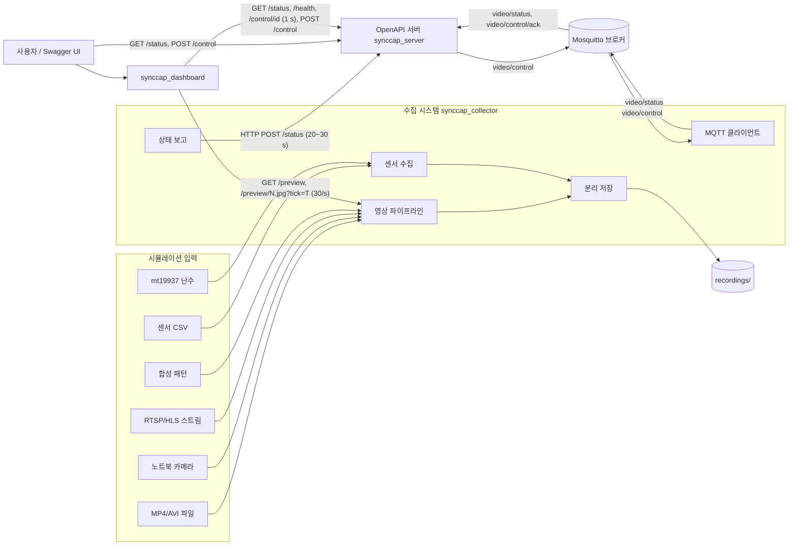
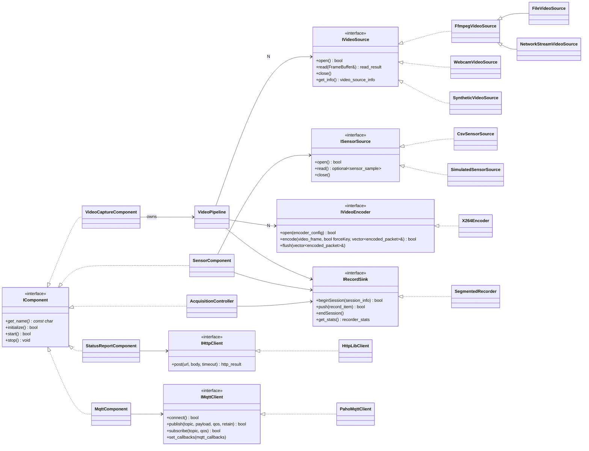
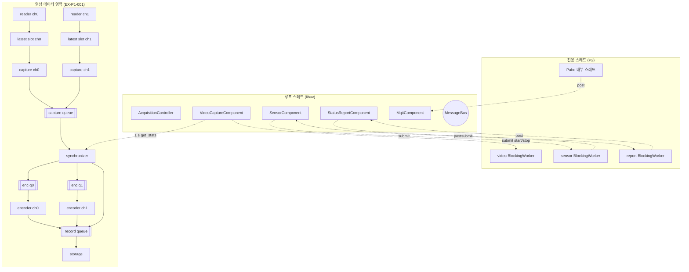
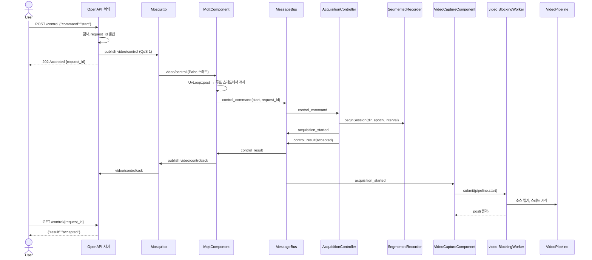
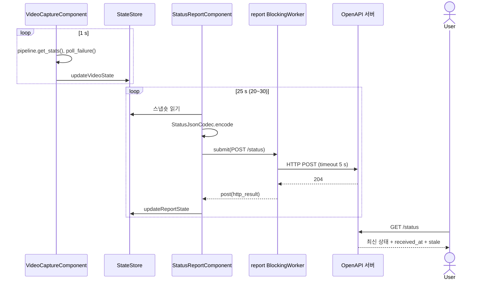
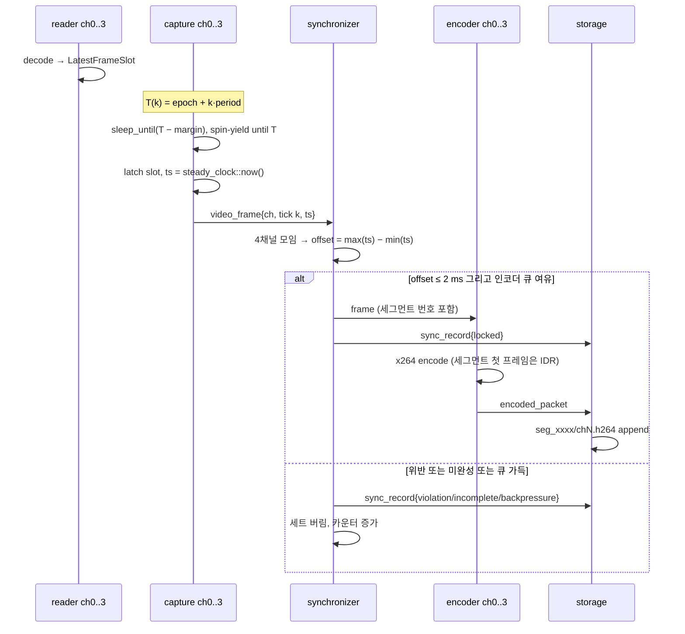

# SyncCap 설계 문서

시뮬레이션 기반 다채널 비디오·센서 데이터 수집 시스템(이하 "수집 시스템")과 상태 집계 서버(이하 "OpenAPI 서버")의 설계 기록이다.
절 순서는 `cpp-conventions` 설계 기록 양식을 따른다. 측정값은 측정 조건과 함께 적고, 측정하지 않은 값은 "미측정"으로 둔다.

## 목차

1. Introduction
2. System Context
3. Architecture
4. Key Design Decisions
5. Safety and Security Design
6. Communication Protocols
7. Failure Detection and Recovery
8. Logging
9. Configuration
10. Build
11. Test Strategy
12. Source Layout
- Appendix A. 설계 중 발견한 문제
- Appendix B. 현장 확인 항목
- Appendix C. 미구현 항목
- Appendix D. 원칙 예외

---

## 1. Introduction

### 1.1 목적

GMSL 디시리얼라이저로 들어오는 3~4채널 2 MP(1920x1080) 카메라 입력과 온·습도·가속도 센서를 하드웨어 없이 시뮬레이션하고, 다음 요구사항을 만족한다. 문서의 다른 절은 이 ID로 요구사항을 가리킨다.

| ID | 기능 | 요구 | 구현 위치 |
| --- | --- | --- | --- |
| R1 | 입력 추상화 | 영상 `IVideoSource`(파일 MP4/AVI, 웹캠, RTSP/HLS), 센서 `ISensorSource`(CSV, mt19937 난수). 시뮬레이터와 실제 입력 분리 | `source/` |
| R2 | 비디오 캡처 | 3~4채널 1920x1080, 채널별 20~30 fps 비동기 캡처 | `pipeline/CaptureWorker` |
| R3 | 프레임 동기화 | 같은 순간 프레임의 채널 간 타임스탬프 차이 ≤ 2 ms, 검증 API와 로그 | `pipeline/FrameSynchronizer`, `pipeline/SyncMonitor` |
| R4 | 스레드 파이프라인 | 캡처 → 인코딩 → 저장 Producer–Consumer 스레드, `std::mutex`/`std::condition_variable`, `std::future`/`std::promise`로 종료와 예외 전파 | `pipeline/` |
| R5 | 인코딩 | libx264 기반 H.264 Annex-B 스트림(`.h264`), 타임스탬프 검증 후 인코딩 | `codec/X264Encoder` |
| R6 | 분리 저장 | 설정 간격(기본 180 s)마다 새 파일, 모든 데이터, `std::filesystem` | `storage/SegmentedRecorder` |
| R7 | 센서 수집 | 온·습도·가속도 주기적 읽기와 기록 | `component/SensorComponent` |
| R8 | 상태 보고 | 20~30 s 간격 HTTP POST로 상태 JSON(`channel_status`, `sync_status`, `sensor_status`), libcurl·Boost.Beast 같은 오픈소스 HTTP 클라이언트 | `component/StatusReportComponent` |
| R9 | IPC/RPC | MQTT `video/status` 발행, `video/control` 수신(start/stop) | `component/MqttComponent` |
| R10 | 서버 | `POST /status`, `GET /status`, `POST /control` → MQTT, OpenAPI 스펙, Docker | `server/` |
| R11 | 시험과 문서 | 단위·통합 시험(동기화 포함), 설계 문서, README | `tests/`, `docs/`, `scripts/` |

### 1.2 범위

| 디렉터리 | 내용 |
| --- | --- |
| `src/` | 수집 시스템과 공용 라이브러리 |
| `server/` | OpenAPI 서버(C++), `openapi.yaml`, `Dockerfile` |
| `dashboard/` | 모니터링 UI(Dear ImGui): `model/`(화면 상태), `net/`(HTTP 스레드: 상태, 영상), `ui/`(창, 뷰, 텍스처) |
| `tests/` | Catch2 단위 시험과 파이프라인 통합 시험 |
| `scripts/` | 샘플 생성, 빌드, 실행, 동기화 검증, 종단 간 시험 스크립트 |
| `config/` | 수집 시스템과 서버 설정, Mosquitto 설정 |
| `samples/` | 샘플 CSV(영상 샘플은 스크립트로 생성) |

### 1.3 용어

| 용어 | 의미 |
| --- | --- |
| tick | 공통 프레임 시계의 k번째 촬영 시점. `epoch + k * period` |
| 래치(latch) | 캡처 스레드가 tick 시점에 소스의 최신 프레임을 집어 타임스탬프를 찍는 동작. GMSL FSYNC에 대응 |
| 프레임 세트 | 같은 tick의 채널별 프레임 묶음 |
| 오프셋 | 프레임 세트 안 타임스탬프의 최댓값 − 최솟값 |
| 세그먼트 | 분리 저장의 한 구간. `floor((t − session_epoch) / interval)` |
| 세션 | start 명령부터 stop 명령까지. 세션마다 디렉터리 하나 |

### 1.4 개발 환경

| 항목 | 값 |
| --- | --- |
| 언어 | C++17 |
| Windows | Windows 11, MSVC 14.50 (Visual Studio 18), Ninja |
| Linux | Ubuntu 24.04, GCC 13, Ninja (WSL2 또는 Docker) |

---

## 2. System Context



### 외부 인터페이스

| Peer | Direction | Address | Protocol | Rate |
| --- | --- | --- | --- | --- |
| OpenAPI 서버 `/status` | we connect | `report.url` (기본 `http://127.0.0.1:8080/status`) | HTTP/1.1 POST, JSON | `report.interval_s` (20~30 s, 기본 25 s) |
| MQTT 브로커 | we connect | `mqtt.host:mqtt.port` (기본 `127.0.0.1:1883`) | MQTT 3.1.1 | 상태 `mqtt.status_interval_ms` (기본 5 s), 제어는 이벤트 |
| 영상 파일 | we read | `video.channels[i].uri` | FFmpeg demux/decode | 소스 고유 fps |
| RTSP/HLS | we connect | `rtsp://...`, `http(s)://.../*.m3u8` | FFmpeg | 소스 고유 fps |
| 웹캠 | we read | 장치 번호 | OpenCV `VideoCapture` | 장치 fps |
| 센서 CSV | we read | `sensor.csv_path` | CSV | `sensor.period_ms` |
| 영상 미리보기 | we listen (수집 시스템) | `preview.bind:preview.port` (기본 `127.0.0.1:8090`) | HTTP/1.1 keep-alive, JSON + JPEG | 대시보드가 약 30/s |
| 서버 REST | we listen (서버) | `server.bind:server.port` (기본 `0.0.0.0:8080`, 컨테이너 안) | HTTP/1.1, JSON | 사용자 요청 |

---

## 3. Architecture

### 3.1 설계 원칙

| Principle | Statement | 이 시스템에서의 의미 |
| --- | --- | --- |
| P1. 하나의 루프 | 컴포넌트 코드는 루프 스레드 하나에서만 실행한다 | 제어 영역(명령, 상태, 보고, MQTT)은 libuv 루프 하나. 영상 데이터 영역은 승인된 예외 EX-P1-001 |
| P2. 블로킹은 밖으로 | 블로킹 호출은 전용 스레드에서만 한다 | HTTP POST, 소스 열기, 파이프라인 시작/정지, 센서 읽기는 `BlockingWorker`. MQTT는 Paho 비동기 API |
| P3. 경계 검사 | 외부 값은 믿지 않는다 | MQTT 제어 페이로드, 서버 JSON, 설정, CSV 행을 받는 지점에서 검사 |
| P4. 조용히 실패하지 않기 | 실패에는 응답하고 버림은 기록한다 | 모든 거절에 이유, 모든 버림에 누적 카운터와 로그, 동기화 위반은 세트별 CSV와 상태 보고 |
| P5. 유한한 자원 | 모든 큐에 상한이 있다 | 큐 목록 3.8절. 프레임 버퍼도 풀 상한으로 메모리 상한을 둔다 |

### 3.2 계층

위에서 아래로만 의존한다.

| 계층 | 디렉터리 | 내용 |
| --- | --- | --- |
| app | `src/app` | `main`, `Application`(조립 루트), 시작/정지 순서 |
| component | `src/component` | 루프 스레드 컴포넌트 5개 |
| pipeline | `src/pipeline` | 영상 데이터 영역 스레드(EX-P1-001): 캡처, 동기화, 인코딩 |
| source / codec / storage / network | `src/source`, `src/codec`, `src/storage`, `src/network` | 입력 추상화, H.264 인코더와 JSON 코덱, 분리 저장, HTTP/MQTT 전송 |
| core | `src/core` | `UvLoop`, `UvTimer`, `MessageBus`, `StateSlot`, `BoundedQueue`, `BlockingQueue`, `BlockingWorker`, `IComponent` |
| model | `src/model` | 값 타입(메시지, 상태, 프레임) |
| config | `src/config` | 타입 있는 설정 구조체와 파서 |
| util | `src/util` | 로거, 시각 |

`network`, `codec`(JSON), `model`, `config`, `util`, `core`의 루프 비의존 부분은 서버와 공유한다(`synccap_common`).

### 3.3 컴포넌트 모델



- 입력 추상화: 영상 입력은 `IVideoSource`, 센서 입력은 `ISensorSource`만 보인다. 시뮬레이터(`SyntheticVideoSource`, `SimulatedSensorSource`)와 실제 입력(파일, 카메라, 스트림, CSV)은 같은 인터페이스 뒤에서 교체된다. 생성은 `VideoSourceFactory`, `SensorSourceFactory`가 설정의 `type` 문자열로 한다(개방-폐쇄: 새 입력은 클래스 하나와 팩토리 한 줄).
- `FileVideoSource`와 `NetworkStreamVideoSource`는 FFmpeg demux/decode 골격 `FfmpegVideoSource`를 공유하고 열기 옵션(반복 재생, RTSP 전송 방식, 타임아웃)만 재정의한다.
- `IRecordSink`는 영상, 동기화 기록, 센서 기록이 함께 쓰는 저장 서비스다. 컴포넌트끼리 서로를 모르고 저장 서비스만 요구 인터페이스로 받는다.

### 3.4 컴포넌트 목록

| Component | Legacy process absorbed | Rate | Responsibility |
| --- | --- | --- | --- |
| `AcquisitionController` | 신규 | 이벤트, 1 s 통계 | start/stop 명령 상태 기계, 세션 생성과 종료, 저장 통계 기록 |
| `VideoCaptureComponent` | 신규 | 이벤트, 1 s 통계 | 영상 파이프라인 시작/정지, 채널·동기화 통계 기록, 파이프라인 오류 전파 |
| `SensorComponent` | 신규 | `sensor.period_ms` (기본 100 ms) | 센서 읽기, 상태 기록, 분리 저장 |
| `StatusReportComponent` | 신규 | `report.interval_s` (20~30 s) | 상태 JSON을 서버로 POST |
| `MqttComponent` | 신규 | `mqtt.status_interval_ms` | `video/status` 발행, `video/control` 수신과 검사, 확인 응답 발행 |

#### AcquisitionController

| 항목 | 내용 |
| --- | --- |
| 책임 | start/stop 명령을 상태 기계로 처리하고 세션 수명과 저장 서비스 세션을 관리한다 |
| 대체 대상 | 신규 |
| 주기 | 이벤트. 저장 통계 1 s |
| 외부 연동 | 없음 |

| 종류 | 이름 | 설명 |
| --- | --- | --- |
| 발행 메시지 | `acquisition_started` | 세션 디렉터리와 epoch가 정해졌을 때 |
| 발행 메시지 | `acquisition_stopped` | 정지 완료 시, 이유 포함 |
| 발행 메시지 | `control_result` | 명령마다 수락/거절과 이유 |
| 쓰는 상태 | `IAcquisitionStatusWriter` | phase, session_id, reason |
| 쓰는 상태 | `IStorageStatusWriter` | 현재 세그먼트, 최근 파일, 쓴 바이트, 버림 수 |
| 구독 메시지 | `control_command` | start/stop |
| 구독 메시지 | `video_pipeline_failed` | 오류 정지 |
| 저장 | `IRecordSink` | `beginSession`, `endSession`, `get_stats` |
| 설정 | `storage_config`, `autostart` | |

| 항목 | 내용 |
| --- | --- |
| 스레드 | 루프 스레드 |
| 상태 기계 | `idle → running → stopping → idle`. 영상 실패나 시작 실패는 `running → stopping → error`, `error`에서 다음 start 허용. `stopping`에서 영상 쪽 응답이 10 s 안에 없으면 세션을 닫고 진행(`stop_timeout`) |
| 거절 이유 | `rejected_already_running`, `rejected_busy_stopping`, `rejected_not_running`, `rejected_storage`(세션 디렉터리 생성 실패) |
| 로그 | `ctrl` / `CMD`, `LIFE`, `STAT` |

#### VideoCaptureComponent

| 항목 | 내용 |
| --- | --- |
| 책임 | `VideoPipeline` 시작/정지를 전용 스레드로 넘기고, 통계를 1 s마다 상태에 기록하며 파이프라인 예외를 버스로 알린다 |
| 주기 | 이벤트, 통계 1 s |

| 종류 | 이름 | 설명 |
| --- | --- | --- |
| 발행 메시지 | `video_pipeline_failed` | 워커 스레드 예외가 `std::future`로 전파되었을 때, 열기 실패 시 |
| 쓰는 상태 | `IVideoStatusWriter` | 채널별 fps, 큐 길이, 버림, 중복, 동기화 보고 |
| 구독 메시지 | `acquisition_started`, `acquisition_stopped` | 파이프라인 시작/정지 |
| 전송 계층 | `BlockingWorker` | 소스 열기(RTSP 연결은 수 초), 스레드 조인 |
| 설정 | `video_config`, `encoder_config` | |

| 항목 | 내용 |
| --- | --- |
| 스레드 | 루프 스레드. `VideoPipeline` 내부 스레드는 EX-P1-001 |
| 큐 | `BlockingWorker` 요청 큐 4, 거절 |
| 실패 감지 | 워커 `std::future`가 예외로 준비됨, 열기 실패, 소스 EOF(반복 재생이 아닐 때) |
| 복구 | 자동 재시작하지 않는다. `video_pipeline_failed` → 컨트롤러가 `error` 상태로 전이, 다음 start 명령으로 재시작 |
| 로그 | `video` / `LIFE`, `STAT` |

#### SensorComponent

| 항목 | 내용 |
| --- | --- |
| 책임 | 주기마다 `ISensorSource`를 읽어 상태에 기록하고 세션 중이면 저장 서비스로 보낸다 |
| 주기 | `sensor.period_ms` (10~10,000 ms, 기본 100 ms) |

| 종류 | 이름 | 설명 |
| --- | --- | --- |
| 쓰는 상태 | `ISensorStatusWriter` | 최신 온도, 습도, 가속도 크기, 읽은 수, 실패 수 |
| 구독 메시지 | `acquisition_started`, `acquisition_stopped` | 저장 여부 |
| 전송 계층 | `BlockingWorker` | 파일 읽기 |
| 저장 | `IRecordSink` | `sensor_record` |

| 항목 | 내용 |
| --- | --- |
| 큐 | 읽기 요청 1, 거절(이전 읽기가 끝나지 않았으면 이번 주기를 건너뛰고 누적 수 기록) |
| 실패 감지 | `read()`가 값을 주지 못함(CSV 끝, 형식 오류) |
| 복구 | CSV는 `sensor.loop=true`면 처음부터 다시 읽음. 형식 오류 행은 버리고 행 번호 기록 |

#### StatusReportComponent

| 항목 | 내용 |
| --- | --- |
| 책임 | 상태 스냅숏을 JSON으로 만들어 OpenAPI 서버에 POST한다 |
| 주기 | `report.interval_s` (20~30 s) |
| 외부 연동 | OpenAPI 서버, we connect, HTTP |

| 종류 | 이름 | 설명 |
| --- | --- | --- |
| 쓰는 상태 | `IReportStatusWriter` | 마지막 성공 시각, 연속 실패 수, 마지막 오류 |
| 읽는 상태 | `IStateReader` | 전체 스냅숏 |
| 전송 계층 | `IHttpClient` on `BlockingWorker` | 연결·읽기 타임아웃 `report.timeout_ms` |

| 항목 | 내용 |
| --- | --- |
| 큐 | 요청 1, 거절(이전 POST가 끝나지 않았으면 이번 주기를 건너뜀) |
| 실패 감지 | 타임아웃, 연결 거부, 2xx가 아닌 응답 |
| 복구 | 다음 주기에 재시도. 20 s 최소 간격을 지키기 위해 빠른 재시도는 하지 않는다 |

#### MqttComponent

| 항목 | 내용 |
| --- | --- |
| 책임 | 상태를 `video/status`로 발행하고 `video/control`을 받아 검사한 뒤 `control_command`로 버스에 넣는다 |
| 주기 | `mqtt.status_interval_ms` (1~60 s, 기본 5 s) |
| 외부 연동 | MQTT 브로커, we connect |

| 종류 | 이름 | 설명 |
| --- | --- | --- |
| 발행 메시지 | `control_command` | 검사를 통과한 제어 명령 |
| 쓰는 상태 | `IMqttStatusWriter` | 연결 여부, 받은 명령 수, 거절 수 |
| 구독 메시지 | `control_result` | `video/control/ack`로 응답 발행 |
| 전송 계층 | `IMqttClient` (Paho MQTTAsync) | 콜백은 Paho 스레드 → `UvLoop::post()` |

| 항목 | 내용 |
| --- | --- |
| 실패 감지 | Paho `connectionLost` 콜백 |
| 복구 | Paho 자동 재접속(1~30 s 지수 백오프), 재접속 시 `video/control` 재구독, `video/online` 재발행 |
| 거절 이유 | `rejected_invalid_json`, `rejected_unknown_command`, `rejected_payload_too_large` |

### 3.5 스레드 모델



채널 수 N에 대한 스레드 수: 루프 1 + 전용 3 + Paho 2 + 데이터 영역(리더 N + 캡처 N + 동기화 1 + 인코더 N + 저장 1). 4채널이면 데이터 영역 14개.

요구사항 R4의 "캡처 스레드 → 인코딩 스레드 → 저장 스레드"는 다음과 같이 대응한다.

| 요구 단계 | 스레드 | 입력 큐 |
| --- | --- | --- |
| 캡처 | `reader ch*`(디코드), `capture ch*`(tick 래치) | `LatestFrameSlot` (1칸, 덮어씀) |
| (동기화 검증) | `synchronizer` | `capture queue` |
| 인코딩 | `encoder ch*` | `enc q*` |
| 저장 | `storage` | `record queue` |

종료와 예외 전파: 데이터 영역의 모든 스레드는 `std::promise<void>`를 가지고 시작한다. 정상 종료 시 `set_value()`, 예외 시 `set_exception(std::current_exception())`. `VideoPipeline::poll_failure()`가 `std::future::wait_for(0)`로 준비된 미래를 찾아 `get()`으로 예외를 다시 던지고 메시지를 돌려준다. `VideoCaptureComponent`가 1 s마다 이를 확인한다.

### 3.6 프레임 동기화 설계

#### 문제

파일, 카메라, 스트림은 각자의 시계로 프레임을 낸다. 30 fps의 프레임 간격은 33.3 ms이므로, 채널별로 "도착한 프레임"에 타임스탬프를 찍으면 채널 간 위상 차이가 0~33 ms 사이에서 임의로 생긴다. 2 ms는 그대로는 만족할 수 없다.

실제 GMSL 시스템은 디시리얼라이저가 FSYNC 신호를 모든 카메라에 동시에 보내 같은 순간에 노출을 시작시킨다. 시뮬레이션에서도 같은 구조를 소프트웨어로 만든다.

#### 해결: 공통 tick + 기한 기반 래치 + 세트 검증

1. `FrameClock`: 세션 epoch(`steady_clock`)와 주기(`1 s / fps`)만 가진 불변 값. tick k의 목표 시각은 `epoch + k * period`. 공유 상태가 없으므로 락이 필요 없다.
2. `reader ch*` 스레드: 소스를 디코드해 `LatestFrameSlot`(1칸)에 넣는다. 디코드 시간의 흔들림이 래치 시각에 영향을 주지 않는다.
   - 비실시간 소스(파일, 합성)가 tick과 같은 fps면 tick `k`의 반 주기 앞(`T(k) − period/2`)에 슬롯을 갱신한다. FSYNC 에지에 맞춰 노출하는 센서처럼 tick마다 새 프레임이 정확히 하나 있다.
   - fps가 다르면(예: 25 fps 파일) 자기 fps로 자유 진행한다. 느리면 직전 프레임을 다시 쓰고(`duplicated`), 빠르면 덮어쓴다(`overwritten`). 둘 다 상태 보고에 나온다.
   - 실시간 소스(카메라, 스트림)는 장치가 속도를 정한다.
3. `capture ch*` 스레드: 모든 채널이 같은 첫 tick(파이프라인 시작 + 300 ms 뒤)부터 래치한다. 다음 tick 목표 시각 `T`를 계산하고 `T − spin_margin`까지 `sleep_until`, 나머지는 `steady_clock`을 확인하며 짧게 양보(spin-yield)한 뒤 `T`에 도달하면 슬롯에서 프레임을 집고 **그 순간의** `steady_clock::now()`를 타임스탬프로 찍는다. 모든 채널이 같은 절대 기한을 목표로 하므로 오프셋은 스레드 깨어남 지터만큼만 생긴다. 알림(condition variable broadcast)으로 깨우는 방식은 깨어나는 순서가 직렬화되어 채널 수에 비례해 지연이 쌓이므로 쓰지 않았다(4.3절).
4. 래치가 늦은 경우(선점 등으로 `T + period/2`를 넘김): 그 tick은 건너뛰고 `missed_ticks`를 누적한다. 타임스탬프를 tick 시각으로 고쳐 쓰지 않는다. 측정값을 그대로 검증에 넘긴다.
5. `FrameSynchronizer`: tick 번호로 프레임을 모아, 모든 채널이 모이면 오프셋을 계산한다.
   - 오프셋 ≤ `sync_tolerance_ms`(2.0): `locked` 세트. 채널별 인코더 큐로 넘긴다.
   - 오프셋 초과: 위반 세트. `drop_unsynced=true`(기본)면 세트 전체를 버린다. 채널 간 프레임 수가 항상 같게 유지된다.
   - 한 채널이 `max_pending_ticks`(기본 3 tick) 안에 오지 않음: 미완성 세트로 버리고 빠진 채널을 기록한다.
   - 인코더 큐 하나라도 꽉 참: 세트 전체를 버린다(채널별로 버리면 채널 간 정렬이 깨진다).
6. `SyncMonitor`: 세트마다 오프셋을 기록한다. 마지막 오프셋, 최근 창(기본 10 s) 최댓값, 전체 최댓값, 위반 수, 미완성 수, 검사 수, `locked`(최근 창에서 위반·미완성 0)를 제공한다.

검증 API와 기록:

| 수단 | 내용 |
| --- | --- |
| API | `VideoPipeline::get_sync_report()` → `sync_report`, `VideoPipeline::isSynchronized()` |
| 상태 보고 | HTTP·MQTT 상태 JSON의 `sync_status` (`max_offset_ms`, `locked`, ...) |
| 세트별 기록 | 세그먼트마다 `sync.csv`: tick, 세그먼트, 채널별 타임스탬프(µs, epoch 기준), 오프셋(µs), 판정 |
| 로그 | 위반 시 `WARN`(처음 1회와 이후 100회마다, 누적 수 포함), 10 s마다 `STAT` 요약 |
| 사후 검증 | `scripts/verify_sync.py`: `sync.csv` 전체 통계, 채널별 `.h264` 프레임 수 일치(`ffprobe`), 세그먼트 길이 |

### 3.7 인코딩과 분리 저장

- `X264Encoder`: libavcodec의 `libx264` 인코더를 이름으로 찾는다(`avcodec_find_encoder_by_name("libx264")`). 다른 H.264 인코더로 대체하지 않는다. 없으면 열기 실패로 기록한다.
  - 입력은 파이프라인 전체에서 I420(YUV 4:2:0 planar)로 통일해 변환 비용을 소스에서 한 번만 낸다.
  - 기본 `preset=ultrafast`, `tune=zerolatency`, B 프레임 없음, GOP = fps, CBR 성향(`bitrate_kbps`), 채널당 x264 스레드 `encoder.threads`.
  - `AV_CODEC_FLAG_GLOBAL_HEADER`를 쓰지 않으므로 libx264가 IDR마다 SPS/PPS를 반복한다. 세그먼트 파일 하나하나가 단독 재생 가능하다.
- 세그먼트 경계: 동기화기가 tick 목표 시각으로 세그먼트 번호를 계산해 프레임에 붙인다. 모든 채널이 같은 tick에서 경계를 넘는다. 인코더는 세그먼트 번호가 바뀐 첫 프레임을 IDR로 강제한다. 저장 스레드는 세그먼트 번호가 바뀐 패킷에서 새 파일을 연다.
- 센서와 동기화 기록도 같은 `SegmentClock`(세션 epoch + 간격)으로 세그먼트를 정한다.
- 디렉터리: `std::filesystem`으로 관리한다.

```text
recordings/
  20261014_130000_synccap-01/            세션
    seg_0000_20261014_130000/          세그먼트 0 (180 s)
      ch0.h264  ch1.h264  ch2.h264  ch3.h264
      sync.csv
      sensor.csv
    seg_0001_20261014_130300/
      ...
```

### 3.8 큐 목록

| Queue | Ceiling | On overflow |
| --- | --- | --- |
| `MessageBus` | 1,024 | 가장 오래된 것 버림, 누적 수 로그 |
| `UvLoop::post` 대기열 | 4,096 | 거절, 누적 수 로그 |
| `LatestFrameSlot` (채널별) | 1 | 덮어씀, `overwritten` 누적 |
| `FramePool` (채널별) | `video.pool_frames` (기본 12) | 리더가 최대 1 주기 대기 후 그 프레임을 버림, `pool_exhausted` 누적 |
| capture queue | 채널 수 × 4 | 가장 오래된 것 버림, 누적 수 로그 |
| encoder queue (채널별) | `video.encoder_queue` (기본 4) | 동기화기가 세트 전체를 버림, `sets_dropped_backpressure` 누적 |
| record queue | 512 | 거절, 종류별 누적 수 로그 |
| video `BlockingWorker` | 4 | 거절, 명령 거절로 응답 |
| sensor `BlockingWorker` | 1 | 거절, 건너뛴 주기 누적 |
| report `BlockingWorker` | 1 | 거절, 건너뛴 보고 누적 |
| `PreviewWorker` 메일박스 | 1 | 새 세트가 덮어씀, `previewsReplaced` 누적 |
| `PreviewWorker` 보관 세트 | 3 | 가장 오래된 것 버림(요청한 tick이 없으면 409) |
| 대시보드 inbox | 256 | 가장 오래된 것 버림, 누적 수 로그 |
| `SyncMonitor` 창 | 4,096 (시간 창 10 s가 먼저 자름) | 가장 오래된 것 버림 |
| 서버 `UvLoop::post` | 4,096 | 거절, HTTP 503 |
| 서버 상태 이력 | 100 | 가장 오래된 것 버림 |
| 서버 대기 중 제어 요청 | 64 | 가장 오래된 것 버림 |

메모리 상한(4채널, 1080p I420 = 3,110,400 B/프레임): 풀 12 × 4 = 48 프레임 ≈ 149 MB. 풀이 프레임 메모리의 상한이다.

### 3.9 시간 계약

| Component | Period | Deadline | Handler budget | Observed worst | Conditions |
| --- | --- | --- | --- | --- | --- |
| capture ch* | 1/fps (33.3 ms @30) | 채널 간 래치 오프셋 ≤ 2.0 ms (요구사항 R3) | 해당 없음(전용 스레드) | 4.4절 | 4.4절 |
| encoder ch* | 1/fps | 평균 인코드 시간 < 1/fps (큐가 쌓이지 않음) | 해당 없음 | 4.4절 | 4.4절 |
| StatusReportComponent | 20~30 s (요구사항 R8) | POST 타임아웃 5 s | 5 ms (기본값: 가장 짧은 루프 주기 100 ms의 10% 이내) | 미측정 | |
| SensorComponent | 100 ms (설정) | 다음 주기 전 | 10 ms (기본값 규칙) | 미측정 | |
| MqttComponent | 5 s | 발행 비동기 | 5 ms | 미측정 | |

루프 계측: `UvLoop`이 콜백 실행 시간 최악값을 기록하고 10 s마다 `STAT`, 예산(10 ms) 초과 시 `WARN`을 남긴다.

### 3.10 메시지 흐름

제어 경로(사용자 → 수집 시스템):



상태 경로(수집 시스템 → 서버):



영상 데이터 경로(한 tick):



### 3.11 상태 관리

`StateStore`가 상태 종류마다 `StateSlot<T>` 하나를 가진다. 쓰기는 상태 종류별 쓰기 인터페이스로 자기 상태만, 읽기는 `std::shared_ptr<const T>` 스냅숏으로 한다.

| State | Writer | Readers |
| --- | --- | --- |
| `acquisition_state` | `AcquisitionController` (`IAcquisitionStatusWriter`) | 보고, MQTT |
| `storage_state` | `AcquisitionController` (`IStorageStatusWriter`) | 보고, MQTT |
| `video_state` | `VideoCaptureComponent` (`IVideoStatusWriter`) | 보고, MQTT |
| `sensor_state` | `SensorComponent` (`ISensorStatusWriter`) | 보고, MQTT |
| `report_state` | `StatusReportComponent` (`IReportStatusWriter`) | MQTT |
| `mqtt_state` | `MqttComponent` (`IMqttStatusWriter`) | 보고 |

---

## 4. Key Design Decisions

### 4.1 제어 영역은 libuv 루프, 영상 데이터 영역은 전용 스레드 파이프라인

- 제어 영역은 이벤트 수가 적고 순서가 중요하다. 루프 하나에서 실행하면 컴포넌트 코드에 락이 없다.
- 영상 데이터 영역은 4채널 × 30 fps × 3 MB의 연속 처리이고, 요구사항 R4가 Producer–Consumer 스레드 파이프라인을 요구한다. 루프 하나로는 인코딩 처리량을 낼 수 없다.
- 두 영역의 경계는 `VideoPipeline`의 세 함수(`start`, `stop`, `get_stats`/`poll_failure`)뿐이다. 승인된 원칙 예외 EX-P1-001(Appendix D).

### 4.2 프레임 메모리는 풀에서, 큐에는 포인터만

1080p I420 프레임 하나가 3 MB다. 4채널 30 fps면 초당 360 MB를 할당·해제하게 된다. 채널별 `FramePool`이 버퍼를 재사용하고, 큐에는 `std::shared_ptr<const FrameBuffer>`만 흐른다. 마지막 참조가 사라지면 사용자 정의 삭제자가 버퍼를 풀로 돌려준다. 풀 크기가 메모리 상한이다.

### 4.3 동기화: 알림 방식 대신 절대 기한 래치

| 방식 | 장점 | 단점 |
| --- | --- | --- |
| 도착 시각 기록 | 단순 | 채널 간 위상 차이 0~33 ms. 요구 불가 |
| 중앙 시계 스레드가 condition variable로 깨움 | 시계 하나 | 깨어나는 순서가 직렬화되어 채널 수에 비례해 지연이 쌓임. 깨운 쪽의 지연이 모든 채널에 더해짐 |
| 같은 절대 기한을 각 스레드가 목표로 sleep + spin | 공유 상태 없음, 채널 독립 | 기한 직전 spin으로 CPU 사용(채널당 주기의 약 `spin_margin/period`) |

세 번째를 택했다. spin 구간은 `spin_margin_us`(기본 1,500 µs)로 조절하고, Windows에서는 `timeBeginPeriod(1)`로 `sleep_until` 해상도를 1 ms로 올린다.

### 4.4 측정 근거

`scripts/benchmark.py --seconds 60 --inputs files` 결과. 측정 최악값이며 WCET가 아니다.

측정 조건: Windows 11 (26200), Intel Core Ultra 7 155H (22 logical cores), 32 GB, MSVC 14.50 Release, 입력 = 1080p30 H.264 MP4 2개 + MPEG-4 AVI 1개(+4채널은 MP4 1개 추가) 디코드, libx264 `ultrafast/zerolatency` 4 Mbps 채널당 x264 스레드 2, 30 fps, 세그먼트 30 s, 측정 60 s(예열 5 s 제외), 브로커·서버 없음, 같은 조건 3회.

| Measure | 3채널 | 4채널 |
| --- | --- | --- |
| CPU 평균 (코어 1개 기준) | 98~101 % | 144~157 % |
| CPU 평균 (머신 전체 기준) | 4.5 % | 6.5~7.1 % |
| RSS 평균 / 최대 | 188~196 / 198 MB | 249~258 / 261 MB |
| 인코드 평균 / 최악 (프레임당) | 3.9~4.3 / 12.8~36.7 ms | 4.1~4.9 / 6.8~29.1 ms |
| 채널 fps 최저 | 29.99 | 29.95 |
| 오프셋 p99 | 114~213 µs | 130~188 µs |
| 오프셋 최대 (locked 세트) | 0.50~1.01 ms | 0.82~1.02 ms |
| 위반 세트 | 0 / 4,061 (전원 관리 해제 후) | 1 / 4,062 |

설계 결정의 측정 근거:

| Measure | Before | After | 변경 |
| --- | --- | --- | --- |
| 시작 직후 incomplete 세트 | 1 / 750 (첫 tick) | 0 / 651 | 공통 첫 tick |
| 합성 소스 duplicated + overwritten (25 s) | 125 + 125 (채널당) | 0 + 0 | 리더를 tick 반 주기 앞에 맞춤 |
| 15.6 ms 늦은 래치 (3채널 60 s) | 4 / 2,031 | 0 / 2,030, 0 / 2,031 | Windows 전원 관리(EcoQoS) 해제 + `timeBeginPeriod(1)` |

남은 위반 1건(4채널, 시작 2 s 뒤): 다른 세 채널은 1.1 ms 안에 래치했고 한 채널만 9.2 ms 선점됐다. 일반 OS의 스케줄링 잡음이며, 시스템이 위반으로 판정해 세트를 버리고 `sync.csv`와 `WARN` 로그에 남겼다. 실시간 커널(SCHED_FIFO, `CAP_SYS_NICE`) 또는 하드웨어 FSYNC에서 다시 측정할 항목이다(Appendix B.1).

### 4.5 OpenAPI 서버도 C++, 같은 UvLoop 하나

- 서버도 수집 시스템과 같은 `UvLoop`를 쓴다. cpp-httplib 요청 스레드는 입력 검사(`StatusJsonCodec::decode` 등 순수 함수)만 하고, `StatusRepository`와 `ControlRelay`를 건드리는 일은 `UvLoop::post`로 넘긴 뒤 `std::promise`/`std::future`로 결과를 기다린다(최대 `request_timeout_ms` 2 s, 넘거나 큐가 차면 503). 저장소 코드에 락이 없다(P1 준수, 예외 불필요).
- Paho 콜백도 같은 루프로 넘긴다. SIGINT/SIGTERM(Windows는 SIGBREAK)도 루프에서 받는다.
- 클래스 이름 `ControlRelay`: 처음 이름 `ControlService`는 Windows API `ControlService`(winsvc.h)와 충돌했다(Appendix A.6).

### 4.6 HTTP 클라이언트는 cpp-httplib

- 요구사항 R8은 HTTP 클라이언트로 libcurl이나 Boost.Beast 같은 오픈소스를 쓰도록 한다. 서버와 클라이언트를 같은 헤더 전용 라이브러리(cpp-httplib 0.61.0)로 구성해 Windows와 Linux에서 추가 바이너리 없이 빌드된다.
- `IHttpClient` 뒤에 있으므로 libcurl 구현으로 교체해도 컴포넌트는 바뀌지 않는다.

### 4.7a 모니터링 UI는 서버의 클라이언트

- `synccap_dashboard`는 수집 시스템에 직접 붙지 않고 OpenAPI 서버의 REST만 쓴다. 서버가 상태 집계 지점이라는 구조를 그대로 따르고, 원격에서도 같은 화면을 띄울 수 있다.
- 스레드 둘: UI 스레드(GLFW 이벤트 대기 50 ms + ImGui 그리기)가 대시보드의 유일한 루프 스레드이고, `ServerClient` 스레드가 HTTP 호출을 전담한다(P2). 결과는 상한 256의 inbox(가장 오래된 것 버림)로 UI 스레드에 넘기고, UI는 프레임마다 최대 64개를 적용한다. `DashboardModel`에는 락이 없다(P1).
- `DashboardModel`은 ImGui와 네트워크에 의존하지 않아 단위 시험한다(해석, 버튼 활성 규칙, 이벤트 생성, 이력 상한, 같은 문서 중복 제거).
- 서버 폴링(1 s)이 수집 시스템의 MQTT 상태 주기보다 빠르면 같은 문서를 여러 번 받는다. 문서의 `timestamp`가 바뀔 때만 그래프 이력에 넣는다. 그래프가 부드럽도록 MQTT 상태 주기 기본값을 1 s로 했다(HTTP 보고 20~30 s와는 별개).
- 검사기 오탐: `verify.sh`의 P1-THREAD가 `ServerClient`의 스레드를 UI 코드로 보고 잡는다. 이 스레드가 P2가 요구하는 전용 네트워크 스레드라서 `NOVERIFY(P1-THREAD)`에 이유를 달았다.

### 4.7b 4채널 영상 뷰어: 수집 시스템의 미리보기

- 영상은 수집 시스템 안에만 있다. 녹화 파일을 다시 재생하지 않고, 수집 시스템이 **동기화를 통과한 세트**의 축소 JPEG를 HTTP로 제공한다. 상태 집계 지점인 서버를 영상 중계로 바꾸지 않았다(서버에 영상 트래픽을 싣지 않음).
- 데이터 경로: 동기화기 → (locked 세트, `preview.fps`에 맞춘 간격의 tick만) → `PreviewWorker` 1칸 메일박스(새 세트가 처리 안 된 세트를 대체) → 미리보기 스레드: `JpegEncoder`(swscale로 축소 + TV→full range, FFmpeg mjpeg) → 최근 3세트 보관.
- 동기화기는 프레임 버퍼의 `shared_ptr`만 복사한다. 축소·인코딩이 늦어도 녹화와 동기화 판정에 영향이 없다. 미리보기가 쥔 버퍼는 세트 하나분(채널당 1장)이라 풀 상한(12) 안에 든다.
- 제공: `PreviewComponent`(루프 컴포넌트)가 `HttpServerHost`(전송 계층, 리스너 스레드)로 `GET /preview`, `GET /preview/{index}.jpg?tick=T`를 받는다. 핸들러는 파싱만 하고 읽기는 `callOnLoop`(core/LoopCall.h)로 루프에서 한다(서버의 `ApiServer`와 같은 방식, 공용 함수로 뽑음).
- **같은 순간 보장**: 대시보드는 메타데이터에서 tick을 받은 뒤 모든 채널을 `?tick=T`로 요청한다. 받는 도중 그 tick이 교체되면 409를 받고 세트 전체를 버린다. 화면에는 항상 한 tick의 4채널만 나온다. 화면마다 세트 안 래치 시각 차이를 겹쳐 표시해 동기화를 눈으로 확인할 수 있다.
- 대시보드: `PreviewClient`(전송 스레드)가 받고 stb_image로 RGBA 디코드, inbox로 UI에 넘김. UI 스레드가 `PreviewTextures`로 OpenGL 텍스처를 갱신(세트 version이 바뀔 때만, 크기가 같으면 `glTexSubImage2D`).
- 비용(4채널, 4.4절과 같은 조건, 40 s, `preview.fps` 10): CPU 136 % → 157 %(코어 1개 기준), RSS 253 → 261 MB, fps 29.97 → 29.99, 오프셋 p99 317 → 192 µs(측정 잡음 범위).
- 30 fps 표시(`config/collector*.json`의 `preview.fps` 30, 대시보드 기본 33 ms 주기): 수집 시스템 CPU는 10 fps 대비 +0.3~0.4코어, 녹화 fps와 동기화 판정은 그대로(40 s, 2회). 대시보드에는 세 가지가 필요했다(A.17): 미리보기 HTTP 연결 재사용(`HttpLibClient(keepAlive)`), 새 세트가 오면 `glfwPostEmptyEvent`로 UI 대기를 바로 깨움, 창이 있는 동안 `timeBeginPeriod(1)`. 결과: 표시율 29.4~29.6 세트/s, 건너뜀 0(대시보드 로그 `[http][STAT] preview sets_per_s`).

### 4.7 MQTT는 Paho MQTT C 비동기 API

- `MQTTAsync`는 연결·발행이 논블로킹이고 자동 재접속을 지원한다. 콜백은 Paho 스레드에서 오므로 수집 시스템은 `UvLoop::post()`, 서버는 서비스 루프 `post()`로 넘긴다.
- 소스(1.3.16)를 `3rdparty/`에 두고 정적 라이브러리로 함께 빌드한다.

---

## 5. Safety and Security Design

| 항목 | 내용 |
| --- | --- |
| 상태 기계 | `AcquisitionController`: `idle`, `running`, `error`. 거절과 정지 이유를 `control_result`와 상태에 남긴다 |
| 시작 시 검증 | 채널 수 3~4, fps 20~30, 해상도 1920x1080, 보고 간격 20~30 s, 세그먼트 간격 ≥ 1 s, 채널 id 중복 금지. 위반 시 실행 거부 |
| 제어 입구 | MQTT `video/control`, 서버 `POST /control`. 페이로드 상한 1 KiB, 명령 화이트리스트(`start`, `stop`) |
| 인증과 암호화 | 시뮬레이션 범위에서는 평문(알려진 제약). Mosquitto는 compose 내부망 전용. 운영 시 MQTT over TLS와 사용자 인증, 서버 앞단 TLS 종단을 둔다(Appendix C) |
| 대기 소켓 | 서버 기본 바인드는 설정값. 컨테이너 안에서는 `0.0.0.0`, 호스트 실행 기본은 `127.0.0.1` |
| 실행 권한 | Docker 이미지는 비 root 사용자 `synccap`으로 실행 |
| 비밀 값 | 없음. MQTT 사용자/비밀번호를 쓰면 환경 변수 `SYNCCAP_MQTT_PASSWORD`에서 읽고 로그에 `***`로 남긴다 |

---

## 6. Communication Protocols

### 6.1 상태 JSON (HTTP `POST /status`, MQTT `video/status`)

요구사항 R8의 기본 세 필드(`channel_status`, `sync_status`, `sensor_status`)를 그대로 두고 필드를 덧붙였다. 받는 쪽은 모르는 필드를 무시한다. `schema_version`이 1이 아니면 서버는 400으로 거절한다.

```json
{
  "schema_version": 1,
  "device_id": "synccap-01",
  "timestamp": "2026-10-14T13:00:25.120Z",
  "uptime_s": 25.1,
  "acquisition": {"state": "running", "session_id": "20261014_130000_synccap-01", "reason": ""},
  "channel_status": [
    {"id": 0, "fps": 29.97, "queue_length": 1, "source": "file", "dropped": 0, "duplicated": 3, "missed_ticks": 0}
  ],
  "sync_status": {"max_offset_ms": 0.412, "last_offset_ms": 0.120, "locked": true, "tolerance_ms": 2.0,
                  "sets_checked": 750, "violations": 0, "incomplete": 0, "max_offset_total_ms": 0.9},
  "sensor_status": {"temperature": 24.5, "humidity": 60.2, "acceleration": 0.03, "samples": 250},
  "storage": {"segment": 0, "bytes_written": 51234567, "files": ["seg_0000_20261014_130000/ch0.h264"], "dropped": 0}
}
```

### 6.2 MQTT 토픽

| Topic | Direction | QoS | Retain | Payload |
| --- | --- | --- | --- | --- |
| `video/status` | 수집 → 브로커 | 0 | yes | 6.1 상태 JSON |
| `video/control` | 서버 → 수집 | 1 | no | `{"command":"start"\|"stop","request_id":"..."}` 또는 평문 `start`/`stop` |
| `video/control/ack` | 수집 → 서버 | 1 | no | `{"request_id":"...","command":"start","result":"accepted"\|"rejected","reason":"..."}` |
| `video/online` | 수집 → 브로커 | 1 | yes | `online`, LWT `offline` |

### 6.3 REST API (서버)

스펙: `server/openapi.yaml` (OpenAPI 3.0.3). Swagger UI: `GET /docs`.

| Method | Path | 응답 |
| --- | --- | --- |
| `POST` | `/status` | 204, 400(형식 오류, 이유 포함), 413(1 MiB 초과), 503(서비스 루프 포화) |
| `GET` | `/status` | 200 최신 상태 + `received_at`, `age_s`, `stale`, `collector_online`; 404(아직 없음) |
| `GET` | `/status/history?limit=N` | 200 최근 N개(최대 100) |
| `POST` | `/control` | 202 `{request_id, command}`, 400(모르는 명령), 503(MQTT 끊김) |
| `GET` | `/control/{request_id}` | 200 `{result: pending\|accepted\|rejected, reason}`, 404 |
| `GET` | `/health` | 200 `{mqtt_connected, last_status_age_s}` |
| `GET` | `/openapi.yaml`, `/docs` | 스펙, Swagger UI |

### 6.4 주의할 점

- `video/status`는 retain이므로 서버가 늦게 붙어도 마지막 상태를 받는다.
- 제어 명령의 최종 결과는 HTTP 응답이 아니라 `video/control/ack`로 온다. HTTP 202는 "브로커에 발행함"까지만 뜻한다.

---

## 7. Failure Detection and Recovery

| Peer | Detection | Recovery |
| --- | --- | --- |
| OpenAPI 서버 | POST 타임아웃 5 s, 연결 거부, 비 2xx | 다음 주기에 재시도, `report_state.consecutive_failures` 증가, 실패마다 `WARN` |
| MQTT 브로커 | Paho `connectionLost`, 연결 실패 콜백 | Paho 자동 재접속(1~30 s), 재구독, `video/online` 재발행. 그 사이 `mqtt_state.connected=false` |
| 영상 파일 | EOF | `loop=true`면 처음으로 되감기, 아니면 채널 종료 → 파이프라인 실패 보고 |
| RTSP/HLS | `av_read_frame` 오류, 무수신 `rw_timeout`(기본 5 s) | 재연결 1 s 간격, 그 사이 슬롯은 직전 프레임 유지(`duplicated` 증가), 끊김 동안 래치는 계속되므로 다른 채널은 영향 없음 |
| 웹캠 | `read()` 실패 | 재열기 1 s 간격 |
| 데이터 영역 스레드 | `std::future`에 예외 | 파이프라인 정지, `video_pipeline_failed`, 컨트롤러 `error` |
| 저장 | 파일 열기·쓰기 실패 | 해당 레코드 버림, `write_errors` 누적, `ERROR` 로그. 다음 세그먼트에서 다시 열기 시도 |
| 수집 시스템(서버 관점) | 마지막 상태가 60 s(2 × 최대 보고 간격)보다 오래됨, `video/online=offline` | `GET /status`에 `stale=true`, `collector_online=false` |

---

## 8. Logging

- 형식: `[수준][HH:MM:SS.mmm][스레드] [태그][분류] 내용 key=value`
- 구현: spdlog 1.16(헤더 전용). 콘솔과 시간별 파일(`logs/YYYY-MM-DD-HH.log`) 같은 형식. 파일은 UTF-8 BOM.
- 태그: `app`, `cfg`, `bus`, `loop`, `ctrl`, `video`, `cap`, `sync`, `enc`, `store`, `sensor`, `http`, `mqtt`, `server`, `test`
- 분류: `LIFE`, `CFG`, `NET`, `TX`, `RX`, `CMD`, `STAT`, `HW`, `PROT`, `SYS`, `TEST`
- FFmpeg 로그는 `av_log_set_callback`으로, Paho 로그는 `MQTTAsync_setTraceCallback`으로 같은 로거에 모은다.
- 보존: 시간별 파일 최대 72개(3일). 넘으면 오래된 것부터 지운다.

---

## 9. Configuration

수집 시스템 `config/collector.json`, 서버 `config/server.json`. 모르는 키는 경고한다. 범위를 벗어난 값은 실행을 거부하거나(안전·요구 관련) 기본값으로 바꾸고 로그에 밝힌다.

| Key | 의미 | 범위 / 기본 |
| --- | --- | --- |
| `device_id` | 장치 이름 | 기본 `synccap-01` |
| `autostart` | 시작 시 수집 시작 | 기본 `true` |
| `video.fps` | tick 주기 | 20~30, 기본 30. 범위 밖이면 실행 거부 |
| `video.width`, `video.height` | 출력 해상도 | 1920x1080 고정 요구. 다르면 경고 |
| `video.sync_tolerance_ms` | 동기화 허용 오프셋 | 0.1~2.0, 기본 2.0 |
| `video.spin_margin_us` | 기한 직전 spin 구간 | 0~5,000, 기본 1,500 |
| `video.drop_unsynced` | 위반 세트 버림 | 기본 `true` |
| `video.pool_frames` | 채널별 프레임 풀 | 6~64, 기본 12 |
| `video.encoder_queue` | 채널별 인코더 큐 | 2~32, 기본 4 |
| `video.channels[]` | `{id, type, uri, loop}` | 3~4개. `type`: `file`, `webcam`, `network`, `synthetic` |
| `encoder.preset`, `encoder.tune` | x264 프리셋 | 기본 `ultrafast`, `zerolatency` |
| `encoder.bitrate_kbps` | 목표 비트율 | 500~50,000, 기본 4,000 |
| `encoder.threads` | 채널당 x264 스레드 | 1~8, 기본 2 |
| `storage.root` | 기록 루트 | 기본 `recordings` |
| `storage.segment_seconds` | 분리 간격 | 1~3,600, 기본 180 |
| `sensor.type` | `simulated`, `csv` | 기본 `simulated` |
| `sensor.period_ms` | 읽기 주기 | 10~10,000, 기본 100 |
| `sensor.seed` | mt19937 시드 | 기본 42 |
| `sensor.csv_path`, `sensor.loop` | CSV 경로, 반복 | |
| `report.url` | 상태 POST 주소 | 기본 `http://127.0.0.1:8080/status` |
| `report.interval_s` | 보고 간격 | 20~30, 기본 25. 범위 밖이면 실행 거부 |
| `report.timeout_ms` | 연결·읽기 타임아웃 | 500~10,000, 기본 5,000 |
| `mqtt.host`, `mqtt.port`, `mqtt.client_id` | 브로커 | `127.0.0.1`, 1883, `synccap-collector` |
| `mqtt.status_interval_ms` | `video/status` 주기 | 1,000~60,000, 기본 5,000 |
| `log.dir`, `log.level` | 로그 | `logs`, `info` |

---

## 10. Build

### 10.1 명령

```bash
# Windows (Developer 환경은 스크립트가 잡는다)
scripts\build_windows.bat Release

# Linux
cmake -S . -B build -G Ninja -DCMAKE_BUILD_TYPE=Release
cmake --build build
ctest --test-dir build --output-on-failure --timeout 300

# 서버 컨테이너 + 브로커
docker compose up --build
```

### 10.2 서드파티

| Library | Version | 출처 | 용도 | 플랫폼 |
| --- | --- | --- | --- | --- |
| FFmpeg (libavcodec, libavformat, libswscale, libavutil) + libx264 | n8.1 GPL shared (BtbN build 2026-10-13, sha256 363bb6b1…1726) | github.com/BtbN/FFmpeg-Builds, `3rdparty/ffmpeg_x264` | 디코드, H.264 인코드 | Windows |
| FFmpeg + libx264 | 배포판 패키지(Ubuntu 24.04: 6.1) | apt | 같음 | Linux |
| Eclipse Paho MQTT C | 1.3.16 (sha256 8b960f51…14c5) | github.com/eclipse-paho/paho.mqtt.c, `3rdparty/paho_mqtt_c` | MQTT | 공통(소스 빌드) |
| cpp-httplib | 0.61.0 (sha256 bc771147…df18) | github.com/yhirose/cpp-httplib, `3rdparty/cpp_httplib` | HTTP 서버·클라이언트 | 공통 |
| nlohmann/json | 3.12.0 | `3rdparty/nlohmann` | JSON | 공통 |
| spdlog | 1.16 | `3rdparty/spdlog` | 로그 | 공통 |
| libuv | 1.51.0 소스 (sha256 27e55cf7…51cd) | github.com/libuv/libuv, `3rdparty/libuv_src` | 루프 | 공통(소스 빌드, 정적) |
| Catch2 | 3.11.0 amalgamated | `3rdparty/Catch2` | 시험 | 공통 |
| OpenCV | 배포판 4.x | apt (선택) | 웹캠 | 찾았을 때만 |
| GLFW | 3.4 소스 (zip sha256 b5ec004b…) | `3rdparty/glfw/glfw-3.4-src` | 대시보드 창, 입력 | 대시보드 (Linux는 X11 개발 패키지 필요) |
| Dear ImGui | 1.92.5 WIP 소스 (2025-10-16 master, zip sha256 19997598…) | `3rdparty/imgui/imgui-1.92.5-wip` | 대시보드 UI, glfw + opengl3 백엔드 | 대시보드 |

FFmpeg GPL 빌드와 libx264는 GPL이다. 배포 시 GPL 조건을 따른다(이 저장소는 소스만 공개하고 FFmpeg 바이너리를 포함하거나 배포하지 않는다. Windows에서는 `scripts/fetch_ffmpeg.ps1`이 받는다).

---

## 11. Test Strategy

| 수준 | 시험 | 판정 기준 |
| --- | --- | --- |
| 단위 | `BoundedQueue`, `BlockingQueue`(상한, 넘침 정책, 닫기, 다중 스레드 스트레스) | 버림 수 일치, 교착 없음(ctest 제한 시간) |
| 단위 | `FramePool` | 상한, 반환 후 재사용, 풀 파괴 후 반환 안전 |
| 단위 | `FrameClock`, `SegmentClock` | tick·세그먼트 경계값 |
| 단위 | `FrameSynchronizer`, `SyncMonitor` | 2.0 ms 경계(1.999 locked, 2.001 위반), 미완성, 백프레셔 시 세트 전체 버림, 창 최댓값 |
| 단위 | `StatusJsonCodec`, `ControlCommandCodec` | 왕복, 모르는 필드 무시, 잘못된 버전·타입 거절, 크기 상한 |
| 단위 | `ConfigLoader` | 범위 경계, 채널 수 2/3/4/5, 모르는 키 경고 |
| 단위 | `CsvSensorSource`, `SimulatedSensorSource` | 형식 오류 행 건너뜀, 반복, 시드 재현성, 값 범위 |
| 단위 | `X264Encoder` | 첫 패킷 IDR + SPS/PPS, 강제 IDR |
| 단위 | `AcquisitionController` | 모든 거절 이유 경로 |
| 통합 | `VideoPipelineIntegrationTest`: 합성 소스 4채널, 3 s, 세그먼트 1 s | 세그먼트마다 4개 `.h264`, 채널 간 프레임 수 일치, 각 파일 첫 NAL이 SPS·IDR 포함, `sync_report.locked`, 위반 0 |
| 통합 | `ServerApiTest`: 서버 서비스를 가짜 MQTT로 띄우고 HTTP로 호출 | `POST /status` → `GET /status` 일치, `POST /control` → 가짜 MQTT가 실제로 받은 페이로드 검사 |
| 종단 간 | `scripts/e2e_test.py`: 브로커 + 서버 + 수집 시스템 | `GET /status` 수신, `POST /control stop` → ack `accepted`, 상태 `idle`, 다시 start |
| 사후 검증 | `scripts/verify_sync.py` | locked 세트 오프셋 ≤ 2 ms, 채널별 픽처 수 = 세그먼트 locked 세트 수, 파일마다 SPS + IDR 시작 |
| 성능 | `scripts/benchmark.py` | 3·4채널 fps ≥ 20, CPU·RSS 기록, 검증 PASS |

### 11.1 실행 결과 (2026-10-14)

| 시험 | 환경 | 결과 |
| --- | --- | --- |
| `synccap_tests` 전체 (109 case) | Windows, MSVC Release | 통과 |
| 영상 뷰어 실제 구동: 수집 시스템(파일 3 + 합성 1) + 대시보드(한 화면), 화면 캡처, 확대·Stop 클릭 자동화, 1440×900과 최대화 두 크기 | Windows | 4채널 같은 tick 표시, 채널별 래치 차이 +0.007~0.014 ms, 약 10~12 세트/s, 정지 시 영상 비움 (`docs/images/dashboard.png`) |
| 대시보드 실제 구동: 브로커 + 서버 + 수집 시스템(파일 3 + 합성 1) + 대시보드, 화면 캡처, Stop/Start 클릭 자동화 | Windows | 표시 정상, Stop → accepted → IDLE 0.6 s, Start → accepted → RUNNING (`docs/images/dashboard.png`) |
| `synccap_tests` 수집 시스템 제외 (25 case) | Ubuntu 24.04 WSL2, GCC 13 Release | 통과 |
| 수집 시스템과 시험 소스 전체 `g++ -fsyntax-only -Wall -Wextra -Wpedantic -Werror` (FFmpeg 헤더는 Windows 배포본) | WSL2, GCC 13 | 경고 0 (링크·실행은 미확인, Appendix B.4) |
| 같은 범위 AddressSanitizer + LeakSanitizer | WSL2, GCC 13 Debug | 통과, 보고 0 |
| 같은 범위 ThreadSanitizer | WSL2, GCC 13 Debug, `setarch -R` | 통과, 보고 0 |
| `e2e_test.py --inputs synthetic` | Windows + Mosquitto 2.0.20 | PASS (세션 2개, 1,011 세트 전부 locked, 최대 0.48 ms) |
| `e2e_test.py --inputs files` | 같음 | PASS (998 세트 전부 locked, 최대 0.53 ms) |
| `verify.sh` (cpp-conventions) | format, cmake, conventions, p1, p2, p3, p5 | pass. tidy·commit은 건너뜀(Appendix C) |

ThreadSanitizer는 WSL2 6.6 커널의 ASLR 배치와 GCC 13 TSan이 맞지 않아 `unexpected memory mapping`으로 시작하지 못한다. `setarch $(uname -m) -R`로 ASLR을 끄고 실행했다.

---

## 12. Source Layout

```text
CMakeLists.txt              타깃: synccap_common, synccap_collector_lib, synccap_collector, synccap_server_lib, synccap_server, synccap_tests
config/                     collector.json(파일 입력), collector.synthetic.json, collector.docker.json, server.json, mosquitto/
docs/DESIGN.md              이 문서
docker-compose.yml          mosquitto + server (+ collector: --profile full)
Dockerfile.collector        Linux 수집 시스템 이미지(합성 입력)
samples/sensor/sensor.csv   센서 CSV 샘플(영상은 scripts/make_samples.py로 생성)
scripts/                    build_windows.bat, make_samples.py, verify_sync.py, e2e_test.py, benchmark.py
dashboard/src/
  model/DashboardModel.*    화면 상태, 해석, 이벤트, 이력, 미리보기 세트 (시험 대상)
  model/MetricSeries.h      그래프용 고정 길이 이력
  net/ServerClient.*        상태 HTTP 스레드: 폴링, 제어 요청, 응답 추적
  net/PreviewClient.*       영상 HTTP 스레드: 같은 tick의 JPEG 4장, stb 디코드
  net/StbImage.cpp          stb_image 구현(JPEG만)
  ui/main.cpp, DashboardApp.*  창(GLFW), ImGui 컨텍스트, UI 루프
  ui/DashboardView.*        ImGui 그리기, 한 화면 배치 (확대한 화면만 기억)
  ui/PreviewTextures.*      OpenGL 텍스처 (UI 스레드)
server/
  openapi.yaml              OpenAPI 3.0.3 스펙 (GET /openapi.yaml, Swagger UI /docs)
  Dockerfile                서버 이미지(multi-stage, 비 root)
  src/main.cpp              서버 조립: UvLoop, BrokerLink(MQTT), ApiServer
  src/ApiServer.*           REST 엔드포인트, 루프로 넘기기(callOnLoop)
  src/StatusRepository.*    최신 상태와 이력 100개
  src/ControlRelay.*        POST /control → video/control, ack 추적
  src/ServerConfig.*        server.json + 환경 변수
src/
  app/        main.cpp, Application(조립 루트, 종료 순서), BuildInfo.h.in
  component/  AcquisitionController, VideoCaptureComponent, SensorComponent, StatusReportComponent, MqttComponent, StatusSnapshot
  pipeline/   (EX-P1-001) VideoPipeline, CaptureWorker, FrameSynchronizer, SyncMonitor, EncodeWorker, FramePool, LatestFrameSlot, FrameClock
  source/     IVideoSource, FfmpegVideoSource, FileVideoSource, NetworkStreamVideoSource, WebcamVideoSource, SyntheticVideoSource, VideoSourceFactory,
              ISensorSource, CsvSensorSource, SimulatedSensorSource, SensorSourceFactory
  codec/      IVideoEncoder, X264Encoder, FfmpegLog, StatusJsonCodec, ControlCommandCodec
  storage/    IRecordSink, SegmentedRecorder, SegmentClock
  (pipeline)  PreviewWorker, IPreviewProvider: 미리보기
  (component) PreviewComponent: GET /preview
  (network)   HttpServerHost: HTTP 리스너 스레드
  (core)      LoopCall: 다른 스레드에서 루프로 넘기고 기한 안에 결과 받기
  (codec)     JpegEncoder: 축소 + MJPEG
  network/    IHttpClient, HttpLibClient, IMqttClient, PahoMqttClient
  core/       IComponent, UvLoop, UvTimer, UvSignal, MessageBus, StateSlot, StateStore, IStateWriter, BoundedQueue, BlockingQueue, BlockingWorker
  model/      FrameBuffer, VideoFrame, RecordItem(std::variant), SensorSample, Messages, States, SystemStatus
  config/     AppConfig, ConfigLoader
  util/       log/Logger(spdlog), TimeUtil
tests/        Catch2 단위·통합 시험 18개 파일, FakeMqttClient, H264Inspect
3rdparty/     ffmpeg_x264, libuv_src, paho_mqtt_c, cpp_httplib, Catch2, nlohmann, spdlog (그 밖의 디렉터리는 이전 프로젝트의 것으로 사용하지 않음)
```

C++17 활용 위치: `std::filesystem`(세션·세그먼트 디렉터리), `std::variant` + `std::visit`(`record_item`을 종류별 기록기로 분기), `std::optional`(센서 읽기, 큐 pop, 실패 보고), `if constexpr`(저장 스레드 분기), `std::shared_mutex`(`StateSlot`), 템플릿(`BoundedQueue<T>`, `BlockingQueue<T>`, `StateSlot<T>`, `MessageBus::subscribe<T>`, `BlockingWorker::submit<Result>`, `ApiServer::callOnLoop<Result>`), `std::future`/`std::promise`(스레드 예외 전파, 서버 요청 대기).

---

## Appendix A. 설계 중 발견한 문제

새로 만든 시스템이라 옮겨 온 결함은 없다. 구현과 시험 중 발견한 문제를 기록한다.

| # | Problem | Consequence | Current answer | How it surfaced |
| --- | --- | --- | --- | --- |
| A.1 | 저장소에 있던 `3rdparty/FFmpeg`는 디코더만 있는 빌드(libx264, libavformat 없음) | H.264 인코딩 불가 | BtbN GPL shared 8.1(libx264 포함)을 `3rdparty/ffmpeg_x264`에 고정. 인코더를 이름(`libx264`)으로 찾고 없으면 열기 실패 | 의존성 조사 |
| A.2 | 저장소에 있던 `3rdparty/libuv`의 `uv.lib`는 x86(32비트) | x64 링크 실패(LNK2019) | libuv 1.51.0 소스를 정적으로 함께 빌드(모든 플랫폼) | 첫 링크 |
| A.3 | 채널마다 첫 래치 tick이 달랐다 | 시작 직후 incomplete 세트 → 처음 10 s 동안 `locked=false` 보고 | 공통 첫 tick(시작 + 300 ms) | 첫 실행의 `sync.csv` 1행 |
| A.4 | 리더와 tick이 같은 30 fps지만 위상이 독립 | 위상이 tick 경계에서 흔들려 프레임의 약 20 %가 중복·덮어쓰기 | 같은 fps의 비실시간 소스는 tick 반 주기 앞에 맞춰 공개 | 첫 실행의 `duplicated=65 overwritten=64` |
| A.5 | Windows 11이 창 없는 프로세스의 `timeBeginPeriod(1)`을 무시(EcoQoS) | 2,031세트 중 4세트가 한 채널만 15.6 ms 늦게 래치 → 위반 | 파이프라인 시작 시 `SetProcessInformation(ProcessPowerThrottling)`로 실행 속도·타이머 해상도 제한 해제 | 벤치마크의 위반 세트(늦은 값이 정확히 타이머 한 주기) |
| A.6 | 클래스 이름 `ControlService`가 Windows API 매크로와 충돌 | 서버 컴파일 실패 | `ControlRelay`로 이름 변경 | 첫 서버 빌드 |
| A.7 | `BlockingQueue::clear()` 첫 구현이 넘침 정책을 잃음 | clear 이후 큐가 항상 reject로 동작 | `BoundedQueue::takeAll()`로 항목만 꺼내고 락 밖에서 파괴 | 작성 중 자체 검토 |
| A.8 | 버린 프레임 버퍼의 삭제자가 풀 락을 잡는데, 큐 락을 쥔 채 파괴될 수 있었음 | 락 두 개를 겹쳐 쥠(교착 위험) | 큐와 슬롯은 버린 항목을 꺼내 락을 푼 뒤 파괴 | 설계 검토(규약: 락을 쥔 채 다른 객체의 락 금지) |
| A.9 | 노이즈 필터를 넣은 AVI 샘플이 579 MB | 저장소·디스크 낭비 | hue 회전 패턴, 8 MB | 샘플 생성 |
| A.10 | 저장소에 있던 `imgui.lib`, `glfw3dll.lib`도 x86, `glfw-3.4/src`는 비어 있음 | 대시보드 x64 빌드 불가 | 같은 폴더의 zip에서 소스를 풀어 정적으로 함께 빌드 | 대시보드 착수 시 `dumpbin` |
| A.11 | 대시보드가 1 s 폴링으로 같은 상태 문서를 여러 번 받아 이력에 넣음 | 그래프가 5 s 계단 모양 | 문서 `timestamp`가 바뀔 때만 이력 추가, MQTT 상태 주기 1 s | 첫 화면 캡처 |
| A.12 | 동기화 그래프가 "마지막 세트" 오프셋을 그림 | 대부분 0으로 보여 정보가 없음 | 최근 10 s 최대 오프셋을 그림 | 첫 화면 캡처 |
| A.13 | MQTT 상태를 1 s로 줄이자 시작 직후 fps가 20으로 보고됨 | 첫 1 s 구간에 소스 열기와 시작 대기 300 ms가 섞임 | 시작 후 첫 통계 구간은 기준값으로만 쓰고 fps는 다음 구간부터 | 종단 간 시험 출력 `fps=[20.04, ...]` |
| A.14 | 상태와 영상이 탭(나중에 페이지 버튼) 둘로 나뉘어 있었음. 탭 선택도 실행마다 달라 보임 | 영상을 보면서 동기화·fps를 함께 볼 수 없음 | 한 화면으로 합침: 왼쪽 영상(16:9 유지)과 채널 표, 오른쪽 동기화·센서·저장·이벤트. 명령 표는 상단의 마지막 명령 표시와 이벤트 로그로 대체 | 사용자 피드백 |
| A.16 | 녹화를 멈춘 뒤에도 마지막 미리보기가 남아 "실시간"처럼 보였음 | 정지 상태를 오해 | 파이프라인 정지 시 미리보기 보관분을 비우고(`GET /preview` 404), 대시보드는 미리보기를 잃으면 화면을 비움 | 화면 캡처 |
| A.17 | `preview.fps`를 30으로 올려도 대시보드는 초당 약 17세트만 표시 | 영상이 끊겨 보임 | ① 요청마다 새 TCP 연결: Windows에서 연결 수립이 간헐적으로 15~25 ms(요청 p90 17.5 ms, 연결 재사용 시 2.7 ms) → 미리보기 클라이언트만 keep-alive ② UI가 이벤트를 최대 50 ms 기다려 화면 갱신이 약 20/s → 새 세트 도착 시 `glfwPostEmptyEvent` ③ 기본 타이머 15.6 ms라 33 ms 주기가 31/47 ms로 흔들림 → 대시보드도 `timeBeginPeriod(1)` | 사용자 체감, 요청 단계별 시간 측정 |
| A.15 | 미리보기 HTTP 리스너 스레드와 대시보드 네트워크 스레드가 루프 계층 디렉터리에 있었음 | 규약 검사 P1-THREAD/P1-LOCK 위반 | `src/network/HttpServerHost`로 옮기고, 대시보드를 `model/ net/ ui/`로 나눔 | `verify.sh` |

교훈: 합성 소스가 실제보다 관대하면 결함이 숨는다. A.4는 합성 소스에서도 실제 파일 디코드와 같은 리더 경로를 거치게 해서 드러났다.

## Appendix B. 현장 확인 항목

| # | Item | How to verify |
| --- | --- | --- |
| B.1 | 실제 GMSL 디시리얼라이저의 FSYNC 지터와 소프트웨어 래치 지터 비교 | 실제 장치에서 `sync.csv` 수집 후 `verify_sync.py` |
| B.2 | 대상 하드웨어(차량 ECU)에서 4채널 libx264 실시간 여부 | `encoder ch*` 평균 인코드 시간 < 33 ms, 인코더 큐 고수위 |
| B.3 | RTSP 카메라 끊김 시 재연결 시간 | 카메라 전원 차단 시험 |
| B.4 | Linux에서 수집 시스템(FFmpeg 포함) 빌드·시험·벤치마크 | `sudo apt install libavcodec-dev libavformat-dev libswscale-dev` 후 `ctest`, `e2e_test.py`, `benchmark.py`. 이 PC의 WSL에는 패키지를 설치할 권한이 없어 수집 시스템을 뺀 범위만 확인했다 |
| B.5 | Docker 이미지 빌드와 compose 실행 | Docker가 있는 Linux에서 `docker compose --profile full up --build` 후 `GET /status` |
| B.6 | 노트북 웹캠 입력 | OpenCV를 설치하고 `-DSYNCCAP_WITH_OPENCV=ON`, 채널 하나를 `{"type":"webcam","uri":"0"}`로 |
| B.7 | Linux(X11)에서 대시보드 | X11 개발 패키지 설치 후 빌드, 원격 X/WSLg에서 표시 |

## Appendix C. 미구현 항목

| Item | Status |
| --- | --- |
| MQTT TLS, 사용자 인증 | 알려진 제약. 시뮬레이션 범위 밖(사용자 이름과 `SYNCCAP_MQTT_PASSWORD`는 지원) |
| HTTPS 상태 보고 | cpp-httplib를 OpenSSL 없이 빌드. `https://`는 설정 오류로 알림 |
| 서버 상태 영구 저장(DB) | 메모리 저장(최근 100개). 재시작 시 사라짐 |
| clang-tidy 검사 | 프로젝트에 `.clang-tidy`가 없고 MSVC `compile_commands.json`이라 `verify.sh`의 tidy 단계를 건너뜀 |
| 커밋 메시지 검사 | 작업 공간이 git 저장소가 아니라 건너뜀 |
| 퍼징(libFuzzer) | `StatusJsonCodec::decode`, `ControlCommandCodec::decode`, `CsvSensorSource::parseRow` 대상. Clang 환경이 없어 미구현 |
| RTSP 서버를 쓰는 자동 시험 | `NetworkStreamVideoSource`는 HLS(로컬 http.server)로만 수동 확인 가능. RTSP 서버(mediamtx 등) 연동 시험 없음 |

## Appendix D. 원칙 예외

| ID | Principle | Location | Reason | Mitigation | Approved by | Review when | Status |
| --- | --- | --- | --- | --- | --- | --- | --- |
| EX-P1-001 | P1 | `src/pipeline/*` (`PreviewWorker` 포함) | 요구사항 R4가 캡처→인코딩→저장 Producer–Consumer 스레드와 mutex/condition_variable을 요구하고, 4채널 1080p 인코딩 처리량은 루프 하나로 낼 수 없다 | 모든 큐에 상한, 큐마다 락 하나, 술어 있는 `wait`만, 락 안에서 콜백 호출 금지, 정지 순서 고정(닫기→조인), 루프와의 경계는 `start`/`stop`(전용 스레드에서)과 `get_stats`/`poll_failure`(복사본 반환)뿐, TSan 스트레스 시험 | 사용자, 2026-10-14 | 하드웨어 FSYNC와 V4L2 이벤트 기반 캡처로 옮길 때 | active |
